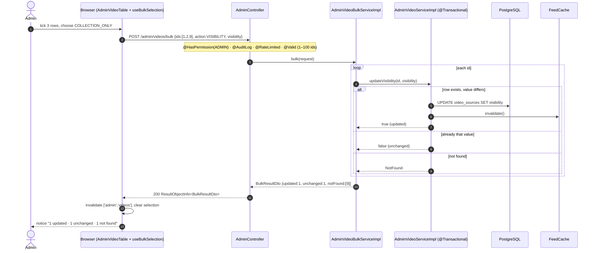
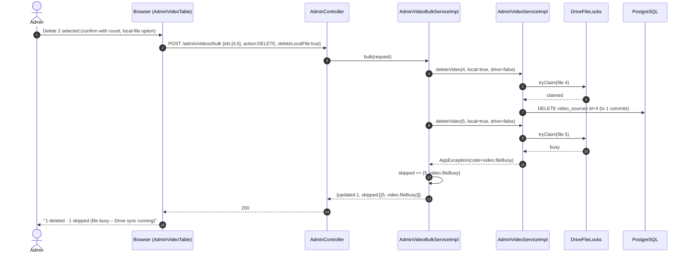
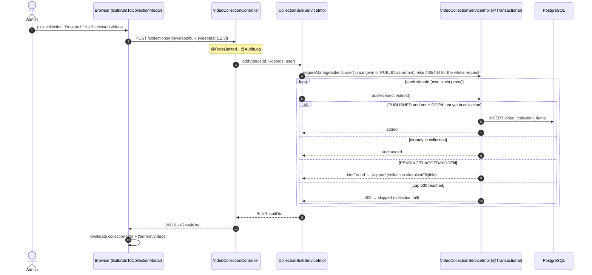
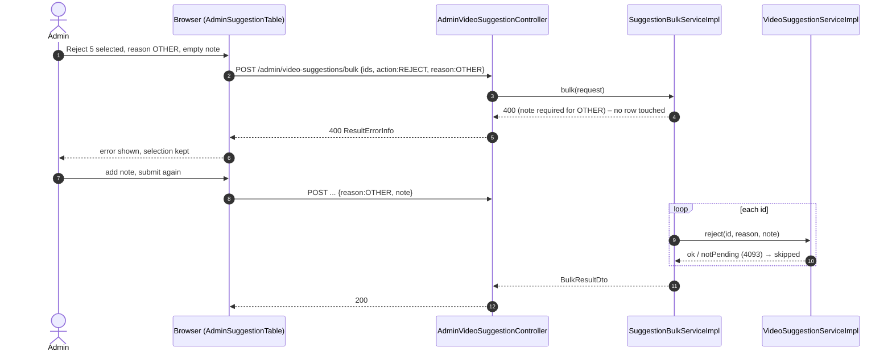
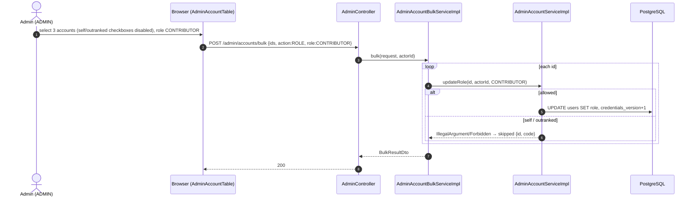

# Sequence Diagrams: Admin Bulk Actions

- **PRD:** [PRD-admin-bulk-actions](../prd/PRD-admin-bulk-actions.md)
- **ADR:** [0036-admin-bulk-actions](../adr/0036-admin-bulk-actions.md)
- **Spec:** —
- **Status:** Draft

## 1. Bulk change video visibility (happy path with mixed rows)

Admin selects rows on Video Vault and picks a visibility in the bulk bar. Each id runs the existing single-row method in its own transaction.

## 2. Bulk delete videos – one row locked by Drive sync

A failure in one row is reported as skipped; the other rows are already committed.

## 3. Bulk add videos to a collection

## 4. Bulk reject suggestions – validation before any row

## 5. Bulk account role change – guards per row

