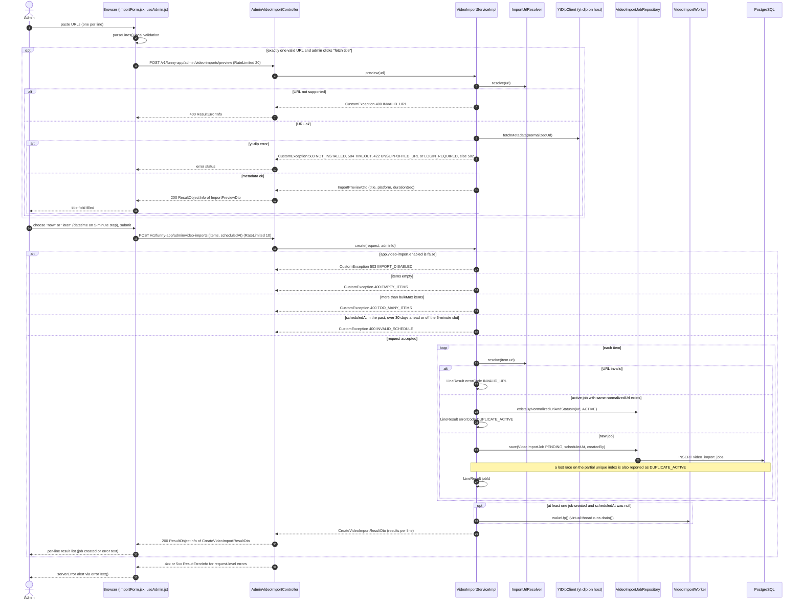
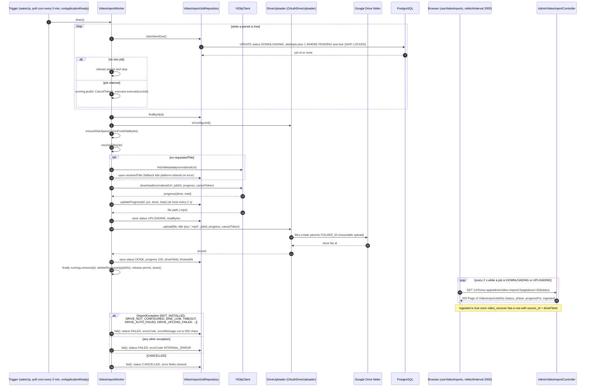
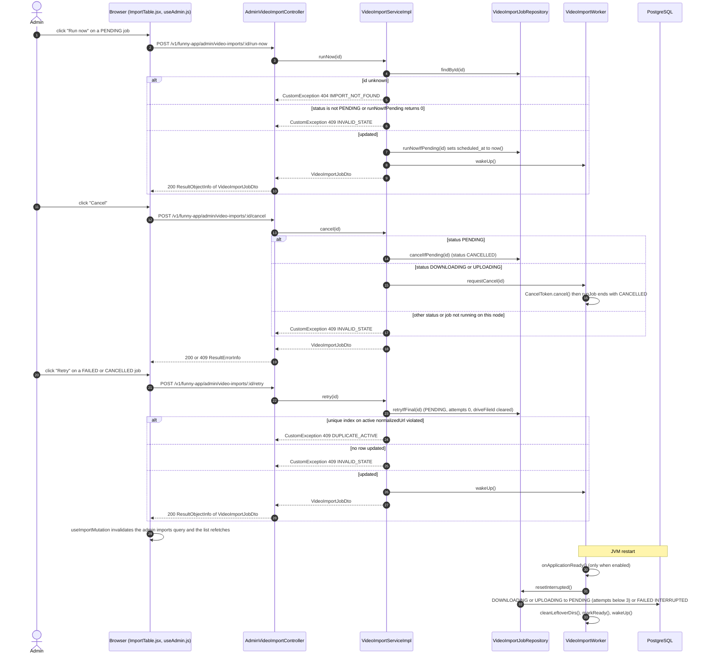
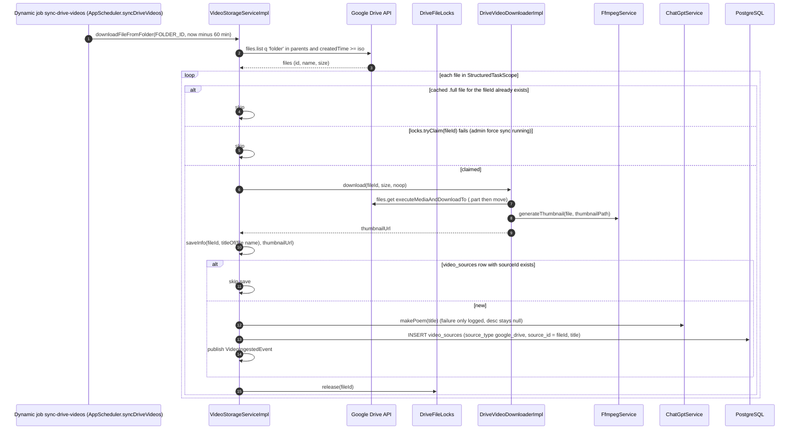
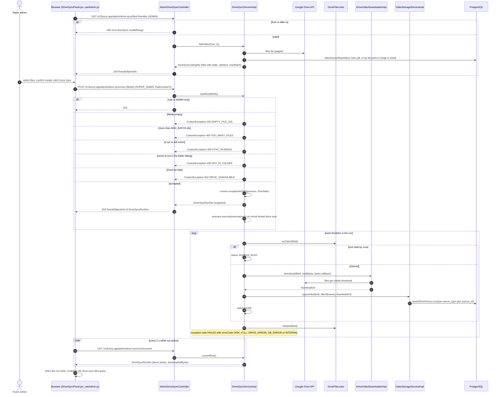

# Sequence Diagrams: Admin Video Import

<!--
One file per feature that has a PRD: docs/sequence/sequence-<feature>.md (slug = PRD slug).
- Mermaid `sequenceDiagram` only (rendered by mkdocs via pymdownx.superfences); no PNG/PlantUML.
- Draw what the code does (or will do, per ADR/spec). Cite the class/method in each participant or note.
- One diagram per main flow: the happy path first, then the important alternative or failure paths
  (auth failure, validation error, async/event, scheduled job). 2-6 diagrams is typical.
- Participants: Browser (React page/hook) → Controller → Service → Repository/DB, plus external
  systems (YouTube, GitHub, SMTP, SSE) and async listeners/jobs. Use `autonumber`.
- Keep in sync: when the as-built flow changes, update the diagram in the same commit.
-->

- **PRD:** [PRD-admin-video-import](../prd/PRD-admin-video-import.md)
- **ADR:** [0019-admin-video-import](../adr/0019-admin-video-import.md)
- **Spec:** — (plans: [plan-admin-video-import](../plans/plan-admin-video-import.md), [plan-admin-drive-force-sync](../plans/plan-admin-drive-force-sync.md))
- **Status:** As-built (2026-10-21)

Notes (code vs plan/PRD):

- Base path for every endpoint is `/v1/funny-app`. Admin endpoints need `hasRole('ADMIN')` plus `@HasPermission(ADMIN)`. In the diagrams `:id` stands for the path variable `{id}`.
- The plan lists `409 DUPLICATE_ACTIVE` and `400 INVALID_URL` as request-level errors for create. In the code `VideoImportServiceImpl.create` returns `200` with a per-line `errorCode` (`INVALID_URL`, `DUPLICATE_ACTIVE`) in `CreateVideoImportResultDto.results`. Only request-level problems are HTTP errors: `503 IMPORT_DISABLED`, `400 EMPTY_ITEMS`, `400 TOO_MANY_ITEMS`, `400 INVALID_SCHEDULE`. `retry` returns `409 DUPLICATE_ACTIVE` when the partial unique index rejects it.
- The import job never writes `video_sources`. It only uploads to the Drive folder, and the Drive sync (cron `sync-drive-videos` or admin force sync) ingests the file.

## 1. Create imports (preview title, run now or schedule)

An admin pastes one or many YouTube or Facebook URLs in the Import tab (`ImportForm.jsx`). With a single valid URL the admin can fetch the title through yt-dlp first. Each line becomes a `PENDING` row in `video_import_jobs`. "Run now" wakes the worker immediately, "Later" stores a `scheduledAt` that must sit on a 5-minute slot.

## 2. Worker runs a job (download, upload to Drive, progress polling)

`VideoImportWorker.drain()` claims the oldest due job with `claimNextDue()` (UPDATE ... FOR UPDATE SKIP LOCKED, sets `DOWNLOADING`), bounded by a Semaphore of `maxConcurrent`. It runs on a virtual thread: disk guard, title resolution, yt-dlp download, upload through `DriveUploader` (`OAuthDriveUploader`, resumable 8 MB chunks), then `DONE` with `drive_file_id`. The work directory is always deleted. The Import tab polls every 2 s while any job is active.

## 3. Run now, cancel, retry and restart recovery

Row actions in `ImportTable.jsx` call three POST endpoints. Each one is a conditional UPDATE, so a stale click gets `409 INVALID_STATE` instead of corrupting a job. After a JVM restart interrupted jobs go back to `PENDING` (attempts below 3) or `FAILED` with `INTERRUPTED`.

## 4. Cron ingest of the uploaded Drive file

The uploaded file is ingested by the same scheduled job as a manual upload: `sync-drive-videos` (registered in `JobRegistry` as `SYNC_DRIVE_VIDEOS`, runs `AppScheduler.syncDriveVideos`). It looks at files created in the last 60 minutes, so the video appears in the app within the cron interval after the upload.

## 5. Admin Drive force sync (SUPER_ADMIN)

Any ADMIN can view the Drive folder against the DB and local cache. Only SUPER_ADMIN can start a force sync of up to `MAX_BATCH` files. One run at a time, executed on a virtual thread, and the page polls every 2 s while the run is active. Each file is claimed with the same `DriveFileLocks` the cron uses, so the two never process one file together.

