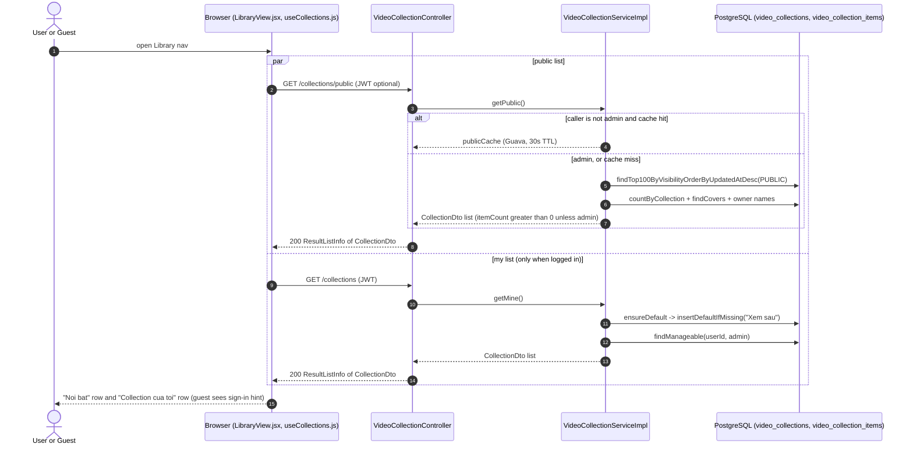
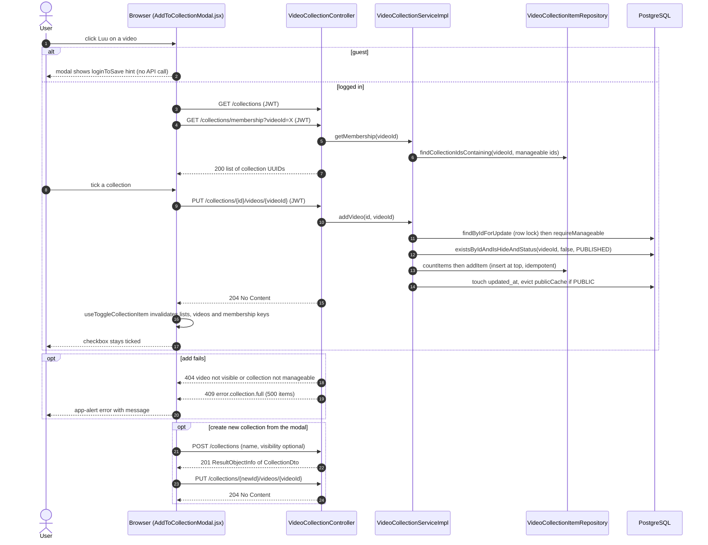
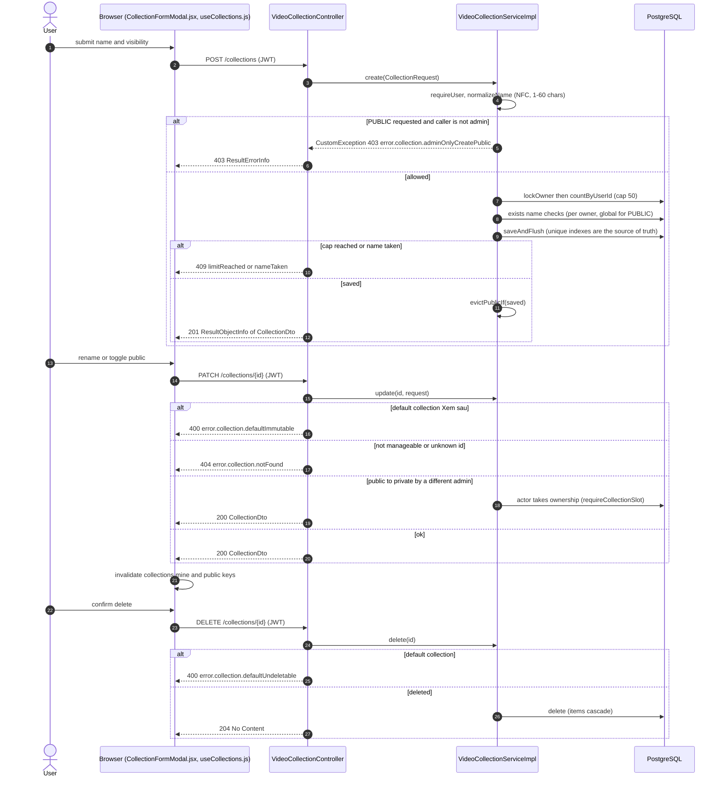
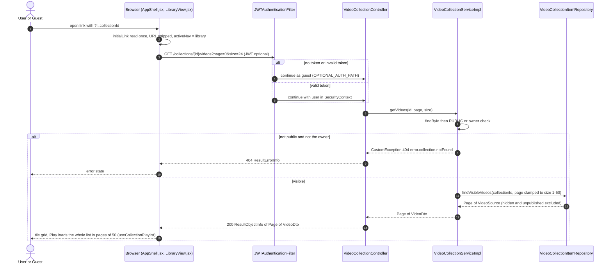
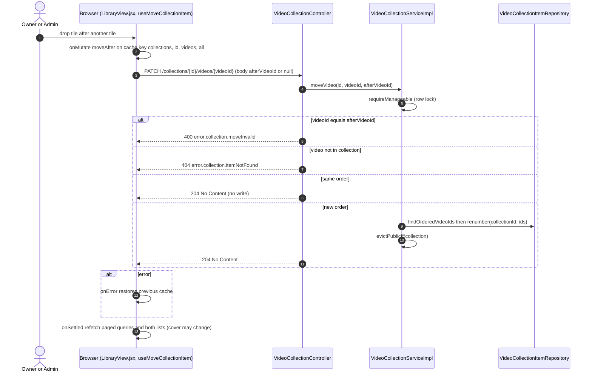

# Sequence Diagrams: Bookmark Feature (Library Collections)

<!--
One file per feature that has a PRD: docs/sequence/sequence-<feature>.md (slug = PRD slug).
- Mermaid `sequenceDiagram` only (rendered by mkdocs via pymdownx.superfences); no PNG/PlantUML.
- Draw what the code does (or will do, per ADR/spec). Cite the class/method in each participant or note.
- One diagram per main flow: the happy path first, then the important alternative or failure paths
  (auth failure, validation error, async/event, scheduled job). 2-6 diagrams is typical.
- Participants: Browser (React page/hook) → Controller → Service → Repository/DB, plus external
  systems (YouTube, GitHub, SMTP, SSE) and async listeners/jobs. Use `autonumber`.
- Keep in sync: when the as-built flow changes, update the diagram in the same commit.
-->

- **PRD:** [PRD-bookmark-feature](../prd/PRD-bookmark-feature.md)
- **ADR:** [0012-bookmark-feature-design](../adr/0012-bookmark-feature-design.md) (amended 2026-10-13: collections-first, no `bookmarks` table)
- **Spec:** — (see [plan-library-collections](../plans/plan-library-collections.md), which supersedes [plan-bookmark-feature](../plans/plan-bookmark-feature.md))
- **Status:** As-built (2026-10-21)

> **PRD vs code.** The PRD (still `Draft`) and `plan-bookmark-feature` describe a `bookmarks` table and `/bookmarks` endpoints. None of that exists in the code. A "bookmark" is an item in the built-in private collection "Xem sau" (Watch later), served by `VideoCollectionController` under `/v1/funny-app/collections`. The code also has two things the plan lists as out of scope or later: manual ordering (`PATCH /collections/{id}/videos/{videoId}`, column `position`) and `GET /collections/{id}/video-ids`. Items are inserted at the top (`MIN(position) - 1`) instead of ordered by `added_at`.

All endpoints below are relative to `/v1/funny-app`. Writes are JWT-only and carry `@RateLimited(permit = 30)` (the reorder PATCH `/{id}/videos/{videoId}` uses `permit = 60`) and `@AuditLog`. `GET /collections/public` and `GET /collections/{id}/videos` are in `OPTIONAL_AUTH_PATH` (guests allowed, a bad token is treated as a guest).

## 1. Open the Library tab (public and my collections)

A guest or user opens the Library nav. Public collections load for everyone, "my" collections only when logged in (the first call lazily creates "Xem sau"). Admins also receive the public collections in `/collections` flagged `canManage`.

## 2. Save a video to a collection (feed "Luu" button)

A logged-in user clicks "Luu" in `VideoSwiper`. `AddToCollectionModal` loads membership, then toggles checkboxes (PUT adds, DELETE removes) or creates a new collection and adds the video in one go.

## 3. Create, rename, change visibility, delete a collection

`CollectionFormModal` calls create or update, the library list's delete action calls delete after `useConfirm`. Only ADMIN or SUPER_ADMIN may make a collection PUBLIC, and the role is re-read from the DB (`userRepo.findById`), not from the JWT.

## 4. Open a collection and play it (including the ?l= deep link)

A shared link `?l=<collectionId>` is read once by `AppShell`, stripped from the address bar and opens `LibraryView` on that collection. Guests can read public collections. A private collection of another user answers 404 so ids cannot be probed.

## 5. Reorder items by drag and drop (managers only)

An owner (or an admin for a PUBLIC collection) drags a tile in `LibraryView`. The cache is reordered optimistically and rolled back if the call fails.

