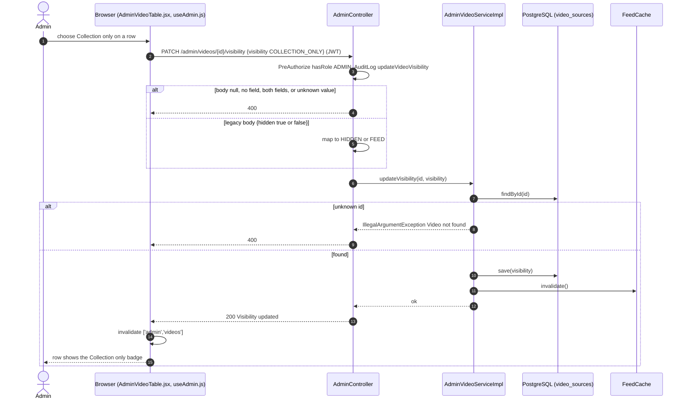
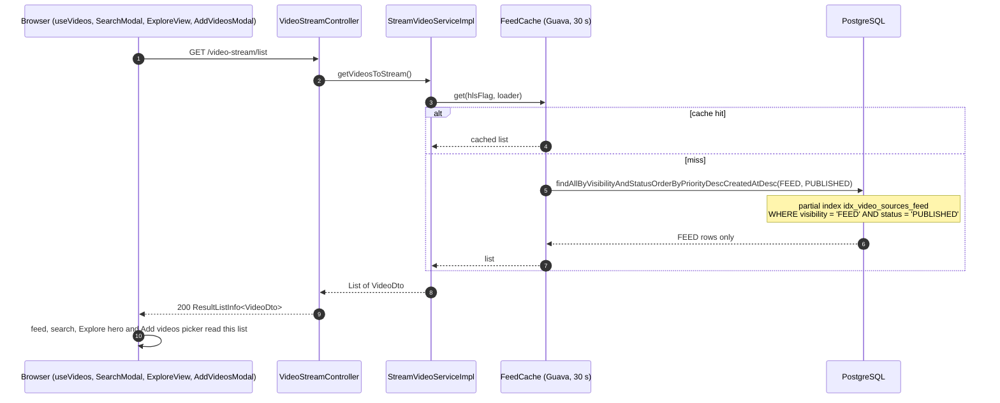
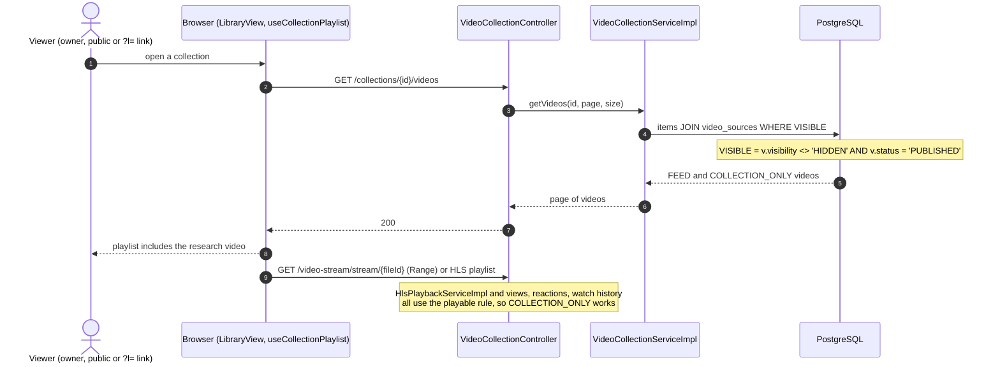
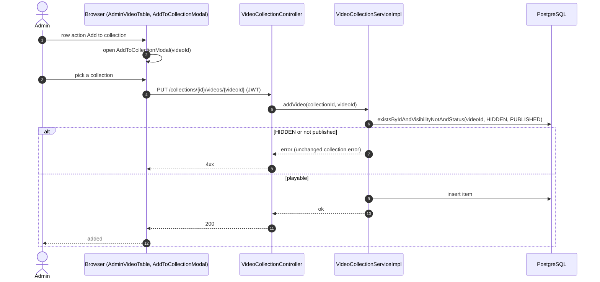
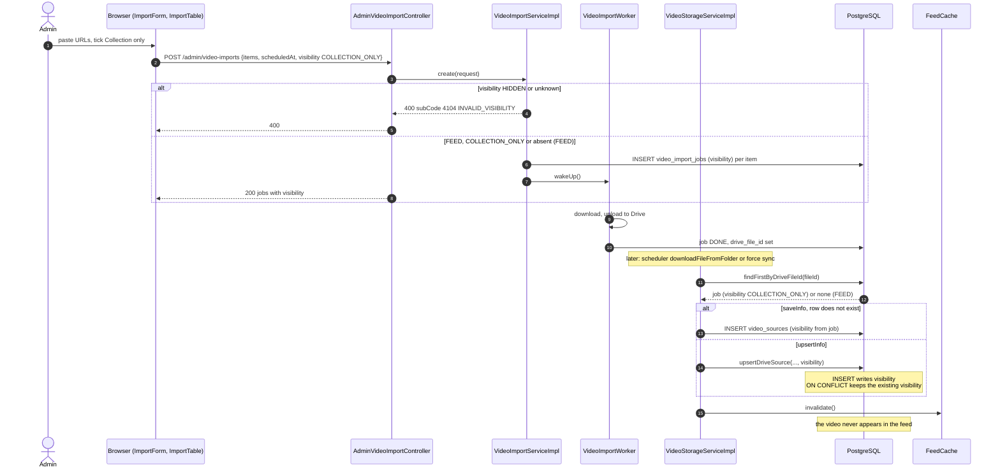
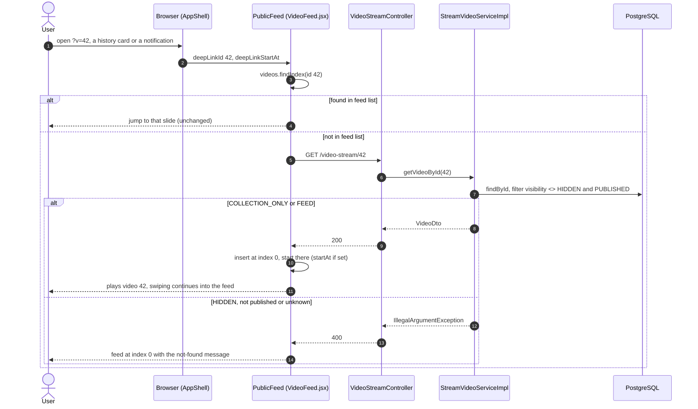

# Sequence Diagrams: Collection-Only Videos

- **PRD:** [PRD-collection-only-videos](../prd/PRD-collection-only-videos.md)
- **ADR:** [0035-collection-only-videos](../adr/0035-collection-only-videos.md)
- **Spec:** [spec-collection-only-videos](../specs/spec-collection-only-videos.md)
- **Status:** Draft (to be marked As-built after implementation)

All paths are under `/v1/funny-app`. `visibility` is one of `FEED`, `COLLECTION_ONLY`, `HIDDEN` (it replaces `is_hide`). Feed rule: `visibility = 'FEED'`. Playable rule: `visibility <> 'HIDDEN'`. Both also require `status = 'PUBLISHED'`.

## 1. Admin changes a video's visibility

The admin picks Feed, Collection only or Hidden in the Admin videos table. The cache is invalidated, so the next feed request reflects the change.

## 2. Feed excludes COLLECTION_ONLY videos

Feed search, the Explore hero and the Library "Add videos" picker filter this same list on the client, so they exclude the video too.

## 3. Collection plays a COLLECTION_ONLY video

## 4. Admin adds a COLLECTION_ONLY video to a collection

The video is not in the feed or the "Add videos" picker, so the admin adds it from the Admin videos table.

## 5. Import with Collection only

The worker only uploads to Drive. The `video_sources` row is created later, by the Drive scheduler (`saveInfo`) or a force sync (`upsertInfo`). Both copy the visibility from the import job found by `drive_file_id`.

## 6. Deep link, history or notification opens a COLLECTION_ONLY video

