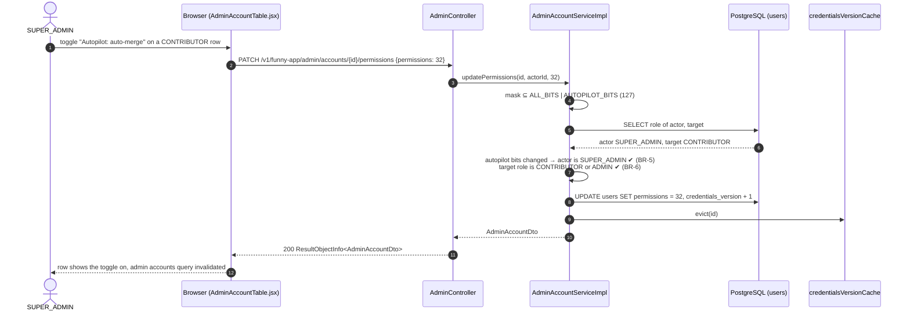
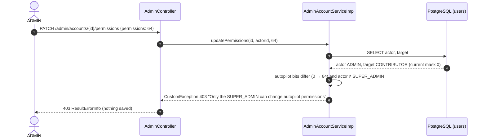
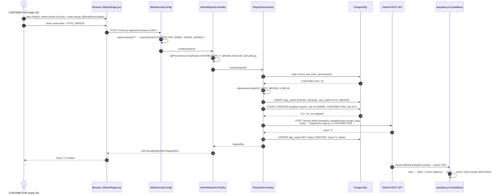
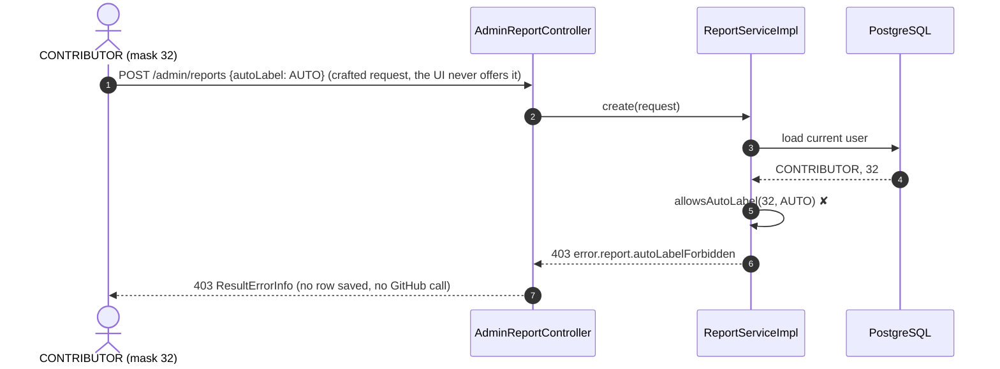
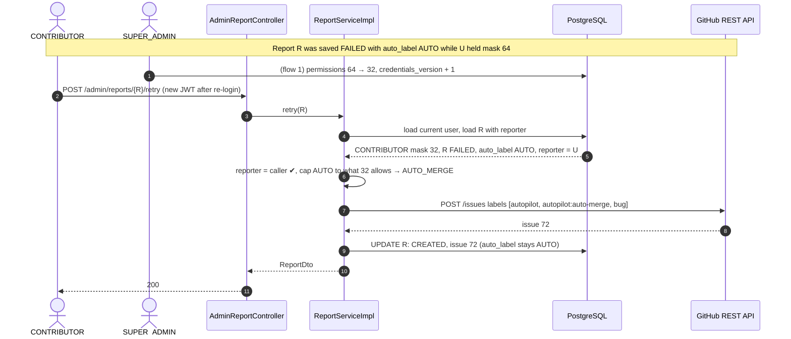
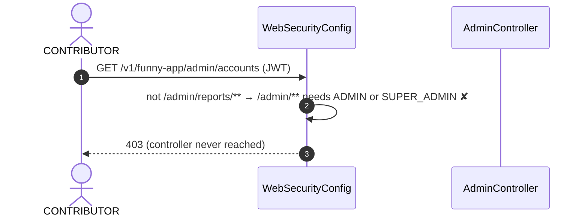
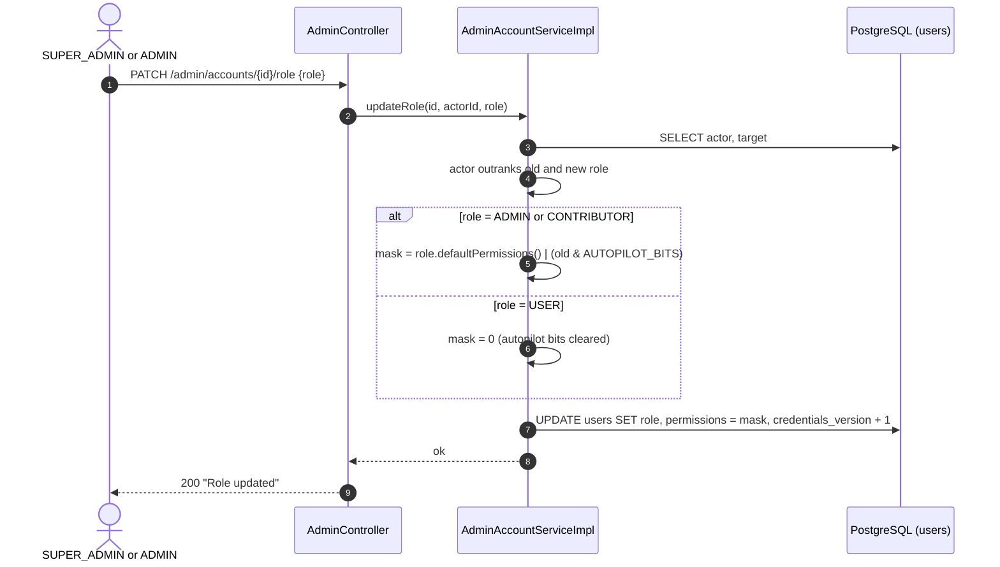

# Sequence Diagrams: Contributor Role and Autopilot Permissions for Reports

- **PRD:** [PRD-contributor-autopilot-permissions](../prd/PRD-contributor-autopilot-permissions.md)
- **ADR:** [0030-contributor-autopilot-permissions](../adr/0030-contributor-autopilot-permissions.md)
- **Spec:** [spec-contributor-autopilot-permissions](../specs/spec-contributor-autopilot-permissions.md)
- **Status:** As-built (2026-10-23)

## 1. SUPER_ADMIN grants an autopilot bit

The owner gives a contributor `AUTOPILOT_AUTO_MERGE` (bit 32) in the account table. Spec BR-5, BR-6.

## 2. ADMIN tries to change an autopilot bit

Spec BR-5, EC-4.

## 3. Contributor sends a report with "Auto-merge" (happy path)

Spec BR-8, BR-11, FR-2, FR-3, FR-6.

## 4. Contributor asks for a label above the grant

Spec BR-9.

## 5. Retry after a partial revoke (label downgrade)

Spec BR-10, EC-1.

## 6. Contributor on another admin endpoint

Spec BR-2, EC-8.

## 7. Role change keeps or clears the bits

Spec BR-7, EC-5, EC-6.

