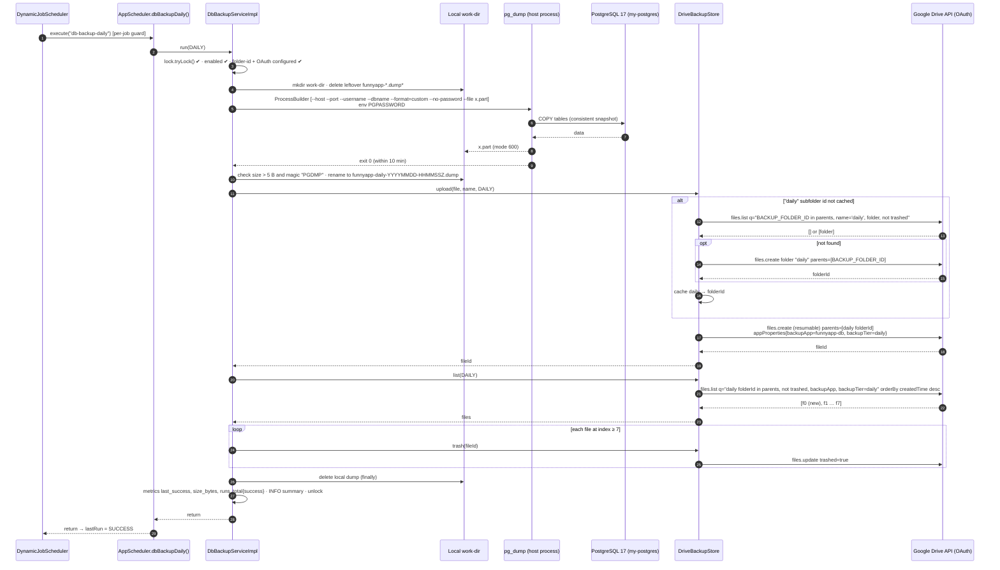
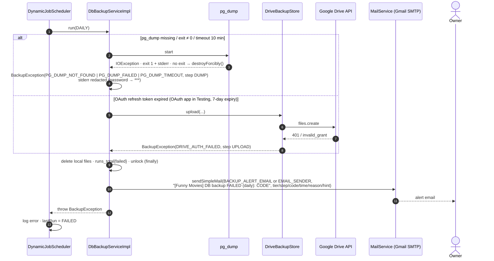
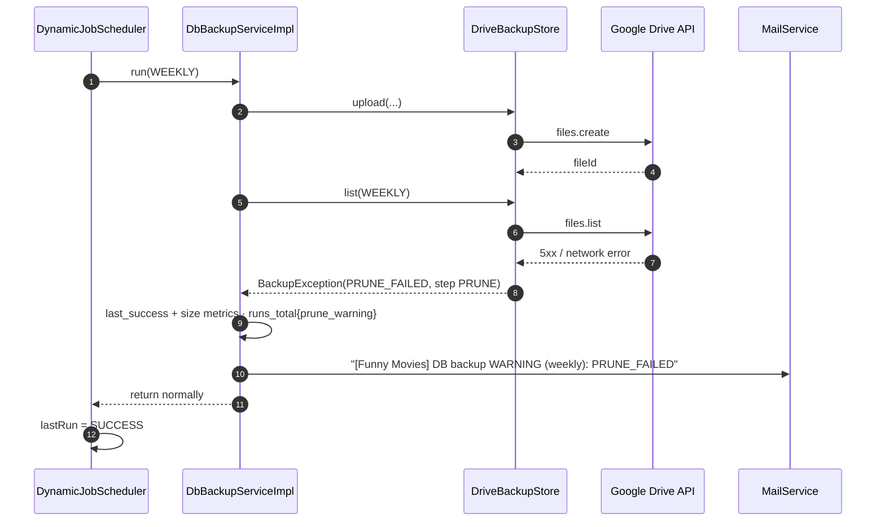
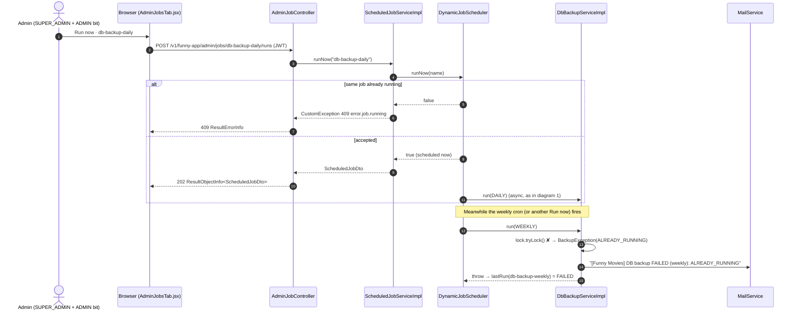
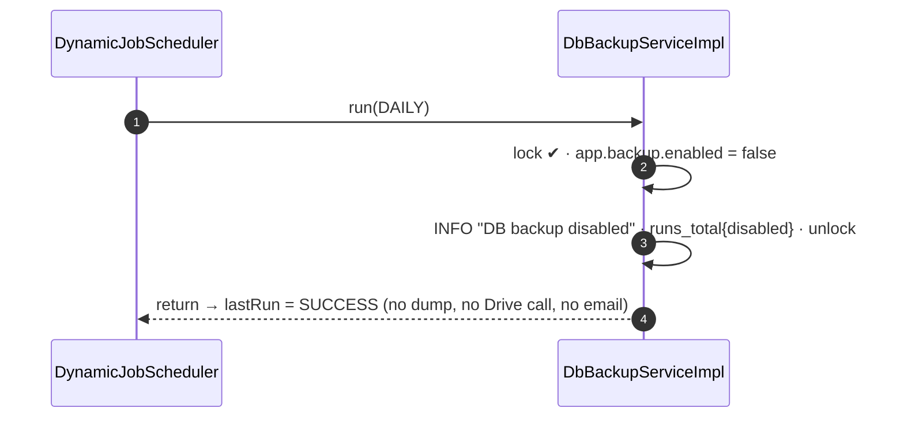
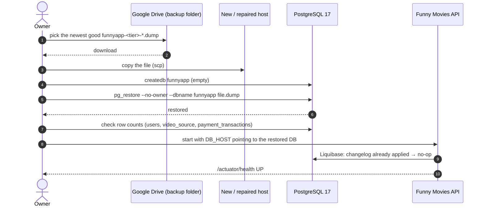

# Sequence Diagrams: Scheduled Database Backups to Google Drive

- **PRD:** [PRD-db-backup-google-drive](../prd/PRD-db-backup-google-drive.md)
- **ADR:** [0039-db-backup-google-drive](../adr/0039-db-backup-google-drive.md)
- **Spec:** [spec-db-backup-google-drive](../specs/spec-db-backup-google-drive.md)
- **Status:** Draft

## 1. Scheduled backup, happy path

The cron of `db-backup-daily` fires (03:00 `Asia/Ho_Chi_Minh`). The run dumps the database with the host `pg_dump`, uploads it to the Drive backup folder with the owner OAuth client, and trashes daily files beyond the newest 7 (spec FR-3..FR-7).

## 2. Dump or upload fails → FAILED + alert email

Any failure before the cleanup (config, `pg_dump`, dump check, Drive upload) stops the run: nothing is trashed, one alert email goes out, and the exception reaches `DynamicJobScheduler`, which records `FAILED` (spec Rule 2, Rule 7, EC-2, EC-3, EC-5, EC-6, EC-9).

## 3. Upload OK, cleanup fails → SUCCESS + warning

The new backup is safe on Drive, so the run counts as a success. The surplus files stay until a later run cleans them up (spec EC-4).

## 4. Admin "Run now", and the cross-tier lock

An admin triggers a run from Admin → Scheduled Jobs. It behaves exactly like a scheduled run (spec Rule 8). A second backup tier started while one is running is refused by the shared lock (Rule 5, EC-7).

## 5. Backups switched off (local / dev)

The seed rows are enabled in every environment; the env switch `BACKUP_ENABLED` (default `false`) keeps local machines quiet (spec Rule 6).

## 6. Manual restore (runbook, outside the app)

Disaster recovery path for v1 (PRD FR-9). There is no restore code in the app.

