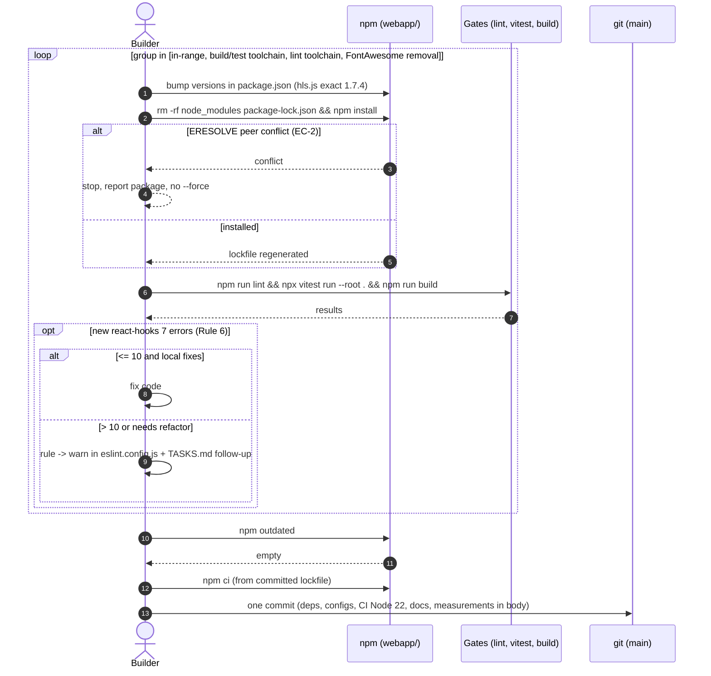
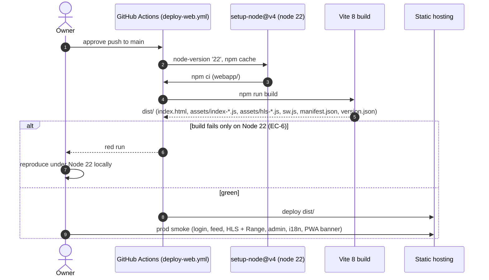
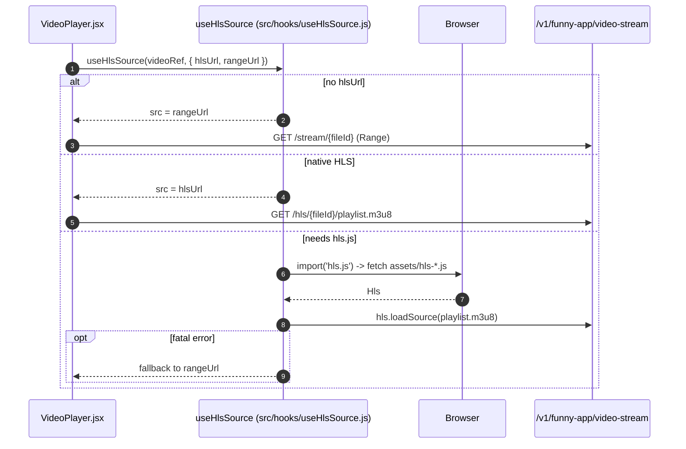
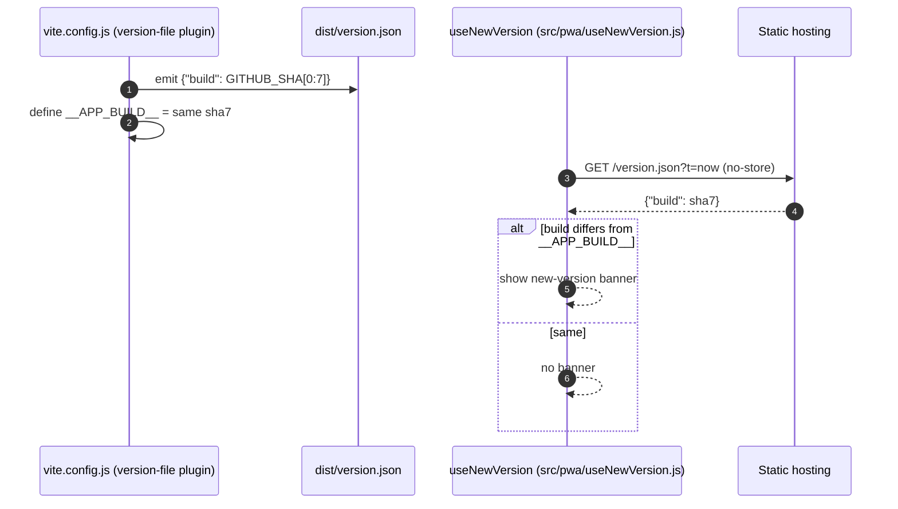

# Sequence Diagrams: Frontend Dependency Upgrade

- **PRD:** [PRD-frontend-deps-upgrade](../prd/PRD-frontend-deps-upgrade.md)
- **ADR:** [0034-frontend-deps-upgrade](../adr/0034-frontend-deps-upgrade.md)
- **Spec:** [spec-frontend-deps-upgrade](../specs/spec-frontend-deps-upgrade.md)
- **Status:** Draft

This change has no runtime API flow of its own. The diagrams show the upgrade workflow, the CI delivery path it changes, and the two runtime behaviours the upgrade must preserve (lazy `hls.js` playback and the PWA new-version check).

## 1. Upgrade and verify in groups, land as one commit

The builder upgrades one package group at a time and runs the gates after each; only when every group is green are the changes committed as one commit (spec Rule 7).

## 2. Delivery: push to main builds on Node 22

## 3. Preserved: lazy hls.js playback

`hls.js` must remain a separate chunk fetched only when a video has `hlsUrl` (ADR-0031); Vite 8's bundler must not merge it into the main chunk (EC-3).

## 4. Preserved: PWA new-version check

The custom `version-file` Vite plugin and the `__APP_BUILD__` define must keep producing a matching pair after the upgrade.

