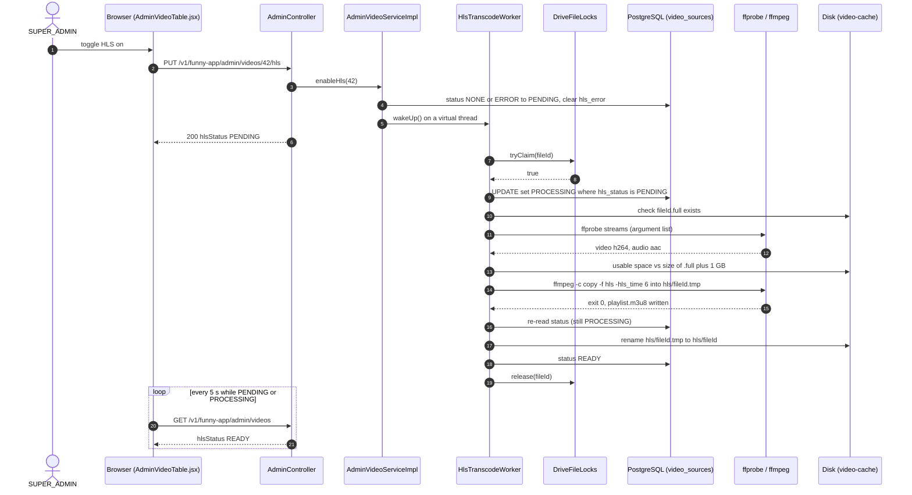
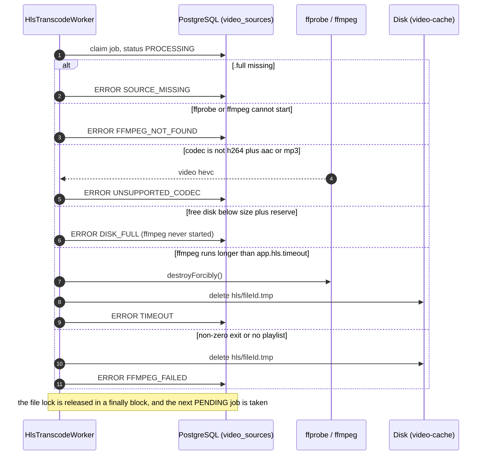
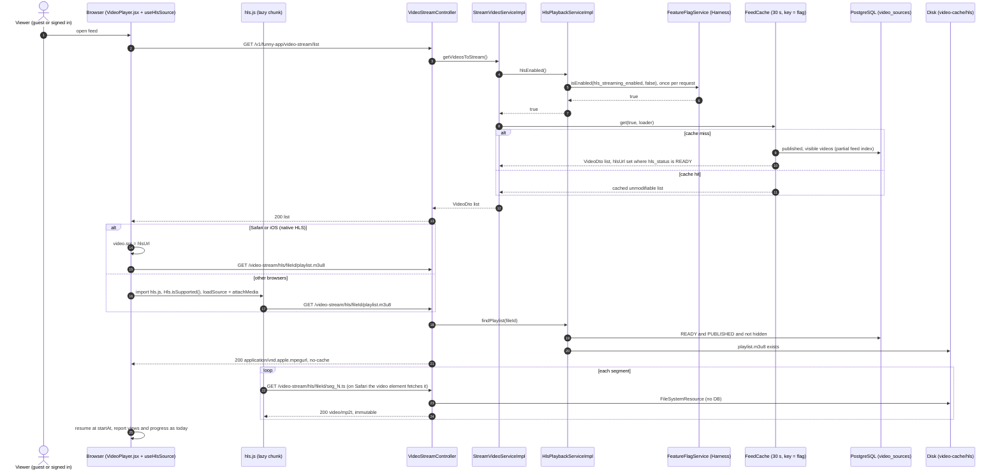
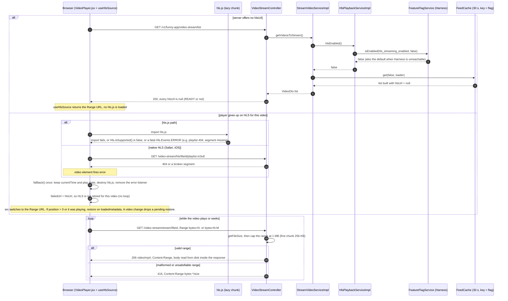
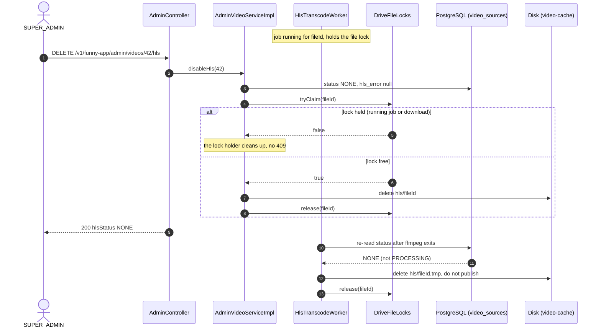
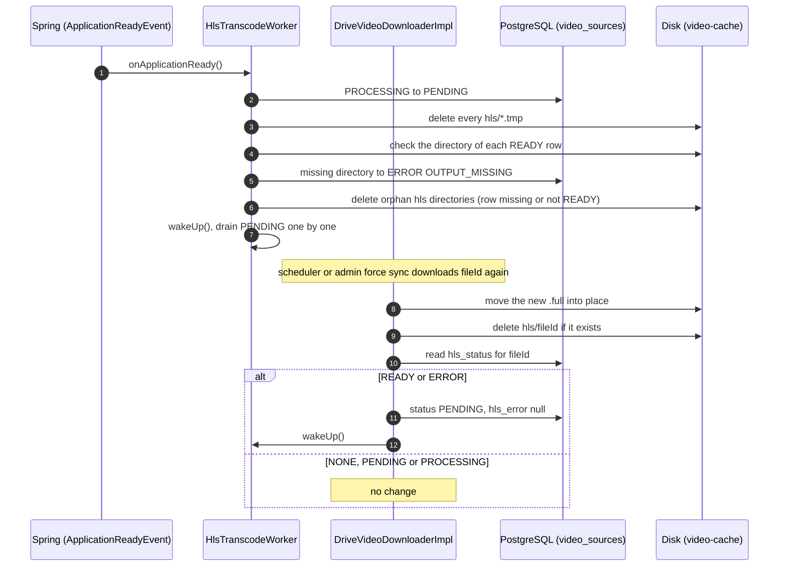

# Sequence Diagrams: HLS Streaming for Selected Videos

- **PRD:** [PRD-hls-streaming](../prd/PRD-hls-streaming.md)
- **ADR:** [0031-hls-streaming](../adr/0031-hls-streaming.md)
- **Spec:** [spec-hls-streaming](../specs/spec-hls-streaming.md)
- **Status:** As-built (2026-10-24; flows 3 and 4 updated for the feed cache, the Range cap and the full fallback triggers)

## 1. SUPER_ADMIN turns HLS on, worker transcodes (happy path)

The SUPER_ADMIN toggles HLS on in the admin table. The worker stream-copies the `.full` file and publishes the rendition atomically (spec FR-2, FR-3, BR-3..BR-7).

## 2. Transcode failures

Each check fails fast and leaves Range untouched (spec BR-9, EC-1, EC-15).

## 3. Viewer plays an HLS video (flag on)

The server offers `hlsUrl` only when the flag is on and the rendition is READY. The flag is read once per request and the feed list comes from a 30 s cache keyed by the flag value. The player attaches HLS to its single video element (spec BR-8, BR-13, FR-9).

## 4. Fallback to Range

Two ways a viewer ends up on Range: the server offers no `hlsUrl` (flag off, Harness unreachable, rendition not READY), or the player gives up on HLS for this video and switches the same `<video>` element to the Range URL (spec EC-2, EC-10, EC-11, EC-12; `webapp/src/hooks/useHlsSource.js`).

## 5. Turn HLS off or delete the video during a job

DELETE wins over a running job: the worker re-reads the status before publishing (spec FR-4, BR-12, EC-6, EC-16).

> DELETE never returns 409. If a running job holds the lock, it discards its output (FR-4). If a download holds it, the downloader deletes the directory (BR-10). Anything still left is removed by the startup orphan sweep (BR-11).

## 6. Startup recovery and a replaced source

Recovery on startup, and a re-download that invalidates the rendition (spec BR-10, BR-11, EC-4, EC-9).

