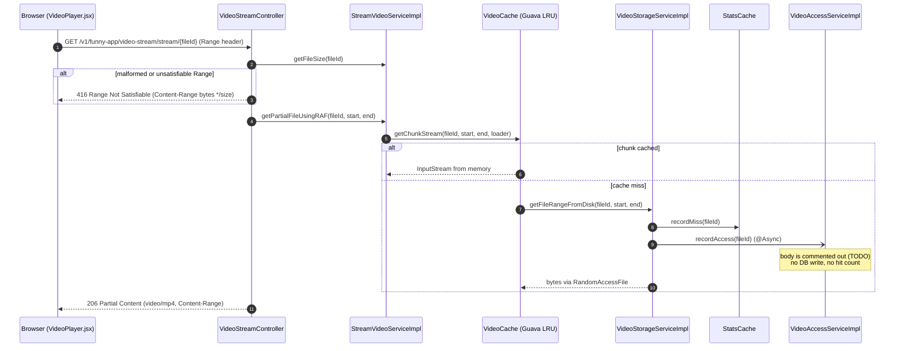
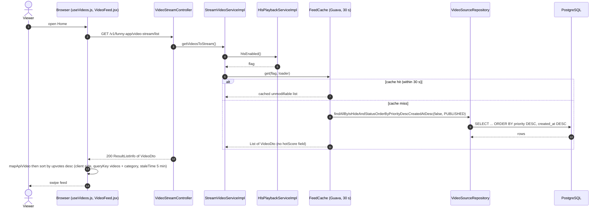
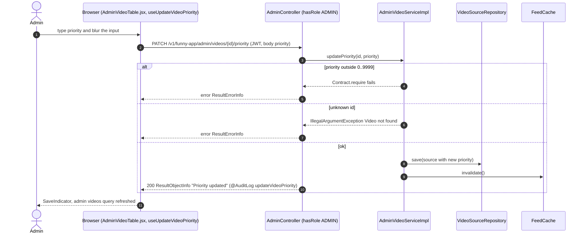
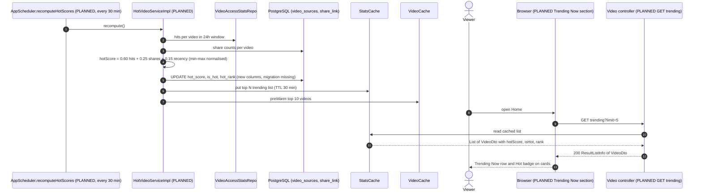

# Sequence Diagrams: Hot Video Priority and Trending Feed

<!--
One file per feature that has a PRD: docs/sequence/sequence-<feature>.md (slug = PRD slug).
- Mermaid `sequenceDiagram` only (rendered by mkdocs via pymdownx.superfences); no PNG/PlantUML.
- Draw what the code does (or will do, per ADR/spec). Cite the class/method in each participant or note.
- One diagram per main flow: the happy path first, then the important alternative or failure paths
  (auth failure, validation error, async/event, scheduled job). 2-6 diagrams is typical.
- Participants: Browser (React page/hook) → Controller → Service → Repository/DB, plus external
  systems (YouTube, GitHub, SMTP, SSE) and async listeners/jobs. Use `autonumber`.
- Keep in sync: when the as-built flow changes, update the diagram in the same commit.
-->

- **PRD:** [PRD-hot-video-priority](../prd/PRD-hot-video-priority.md)
- **ADR:** [0011-hot-video-priority](../adr/0011-hot-video-priority.md)
- **Spec:** — (see [plan-hot-video-priority](../plans/plan-hot-video-priority.md) and [plan-vid2-hot-score-migration](../plans/plan-vid2-hot-score-migration.md))
- **Status:** Draft (the hot score is NOT implemented. Flows 1-3 are as-built, flow 4 is planned only)

> **Planned vs built.**
> - **Built:** manual `priority` column (0-9999) on `video_sources`, set by an admin and used for feed ordering. The `VideoAccessStats` entity and repo, the `VideoAccessService.recordAccess(String)` signature, and a `cleanUpOldVideos` job whose delete step is commented out.
> - **Not built:** `recordAccess()` body (commented out with a TODO), the Liquibase migration for `hot_score`, `is_hot`, `hot_rank`, `HotVideoService` / `HotVideoServiceImpl`, `HotVideoProperties` (`app.hot-video.*`), the `recomputeHotScores()` job, `GET /videos/trending`, `sort=hot`, cache pre-warming, and the frontend Hot badge. There is no server trending endpoint or section. `ExploreView.jsx` shows a "Trending Now" hero badge, but it is client side only: the hero is the first video of the list from `useVideos`, sorted by upvotes, views or newest (default upvotes). A grep for `hotScore` / `hot_score` in `api/src` returns nothing.
> - **PRD vs code.** The PRD uses paths `/api/videos`, `/api/videos/trending`. The real feed endpoint is `GET /v1/funny-app/video-stream/list`, and there is no `/videos` list endpoint. `recordAccess` is called only inside `getFileRangeFromDisk`, so even once implemented it would count cache misses, not every stream request as the PRD (FR-1) intends. The web client (`useVideos`) re-sorts the list by `upvotes` descending, which can override the server order except for ties.

## 1. Stream a video chunk (access recording is a no-op today)

The browser requests byte ranges. A chunk-cache hit never touches disk. On a miss the service reads the file, records a cache miss in `StatsCache`, and calls `recordAccess`, which does nothing yet.

## 2. Home feed ordering (manual priority, then newest)

The feed is ordered by the `priority` column, not by a hot score. There is no `sort` parameter.

## 3. Admin pins a video with a manual priority

This is the only "hot" lever that exists. An admin edits the priority cell in the video table.

## 4. PLANNED: scheduled hot score recompute and trending read

Not implemented. Drawn from PRD FR-2 to FR-8, ADR-0011 and `plan-hot-video-priority`. Names such as `HotVideoServiceImpl` and `recomputeHotScores` are the planned names and do not exist in the code.

