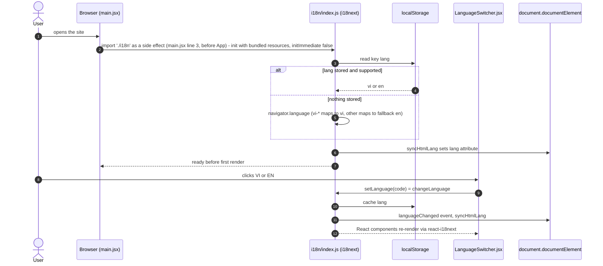
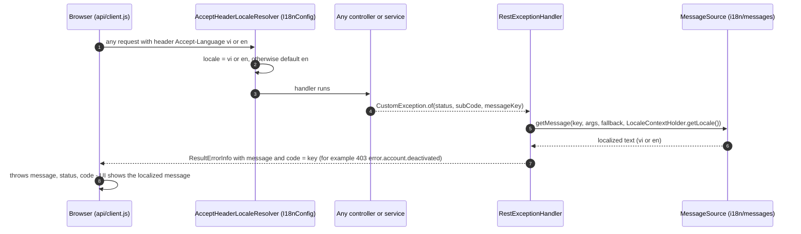
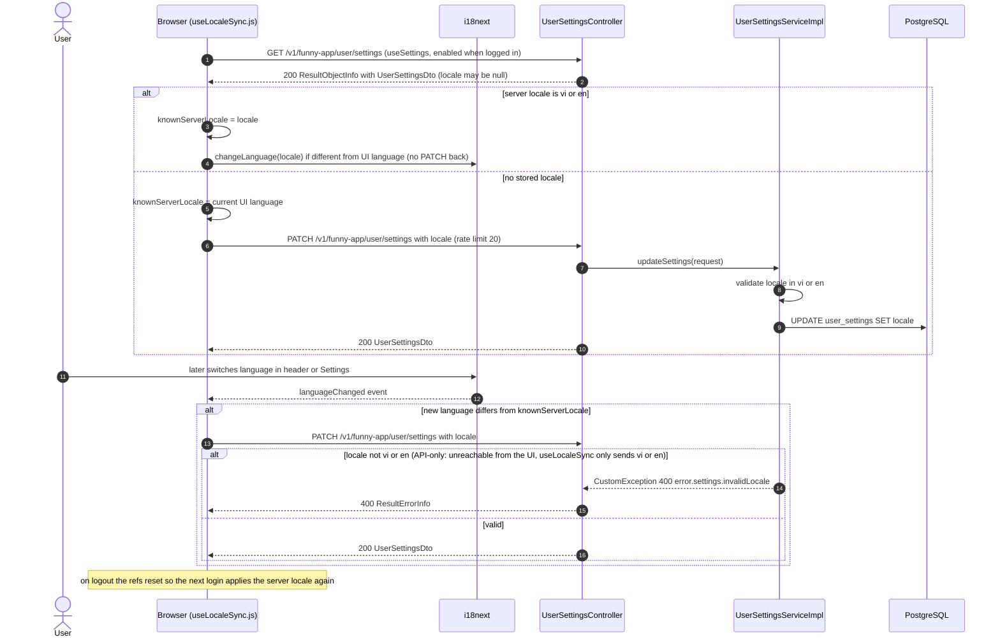
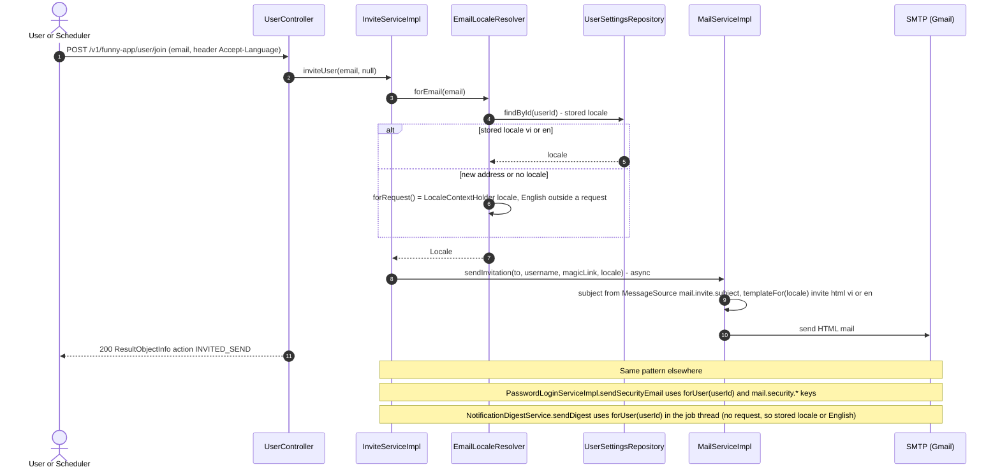

# Sequence Diagrams: Vietnamese + English language support (i18n)

- **PRD:** [PRD-i18n](../prd/PRD-i18n.md)
- **ADR:** [0020-i18n-vietnamese-english](../adr/0020-i18n-vietnamese-english.md)
- **Spec:** —
- **Status:** As-built (2026-10-21)

All endpoints are under `/v1/funny-app`. Supported languages are `vi` and `en` (`SUPPORTED_LANGUAGES` in `webapp/src/i18n/index.js`, `I18nConfig.SUPPORTED` in the API).

## 1. First visit and language switch (browser only)

`i18n/index.js` bundles every `locales/lng/namespace.json` and detects the language in the order localStorage key `lang`, then `navigator`. Unsupported languages fall back to `en`. `LanguageSwitcher.jsx` calls `setLanguage(code)`, which stores the choice in localStorage (detector cache) and updates `<html lang>`.

## 2. Every API call carries the language and errors come back localized

`api/client.js` adds `Accept-Language` from `i18n.language` to every request. On the server, `AcceptHeaderLocaleResolver` (restricted to vi and en, default en) sets the locale and `RestExceptionHandler` resolves the message key from `messages.properties` or `messages_vi.properties`. The key is also returned as `error.code`.

## 3. Logged-in user: locale persisted and applied across devices

`useLocaleSync()` runs in `AppShell.jsx`. Once per login the stored server locale wins over the local one. If the server has none, the current UI language is saved. Any later change is sent once as `PATCH /user/settings` with `locale`. `knownServerLocale` prevents a PATCH loop.

## 4. Localized emails (magic link, security notice, digest)

Emails are sent without a browser, so the locale is resolved on the calling thread by `EmailLocaleResolver` and passed on as a plain `Locale` (ADR-0020 D6): stored `user_settings.locale`, else the request locale (only inside a web request), else English. The magic link send is `@Async`, the notification digest runs from a job.

## Notes: PRD vs code

- PRD requirement 1 says the Settings switcher is logged in only. As built, `SettingsPage.jsx` embeds the same `LanguageSwitcher` as the header, and the Settings route itself needs login, so this matches.
- PRD says the first visit with a `vi-*` browser shows Vietnamese and anything else English. As built this comes from i18next `supportedLngs` + `nonExplicitSupportedLngs` + `fallbackLng: en`, not from custom code.
- `Accept-Language` is sent as the raw `i18n.language` (it can be `vi-VN`), and the server resolver matches on language only.
- Not every backend error is localized: `handleHttpMediaTypeNotSupported`, `handleEntityNotFound` and `handleIllegalArgumentException` (uses `ex.getMessage()`) in `RestExceptionHandler` use plain text, and the `HttpClientErrorException` overload of `handleAuthenticationException` passes the upstream body through. The `AuthenticationException` overload is localized (`KEY_BAD_CREDENTIALS`). The JWT filter writes its 401 straight from `UnauthorizedException.toJson()` (codes such as `TOKEN_REVOKED`), so those bodies are not localized either. Only keyed `CustomException` and the validation, missing-parameter and rate-limit handlers go through `MessageSource`.
- The password set, change and remove notices are plain-text mails localized by `messages*.properties` keys (not HTML templates). The invite mail is the only HTML template (`templateFor`).
