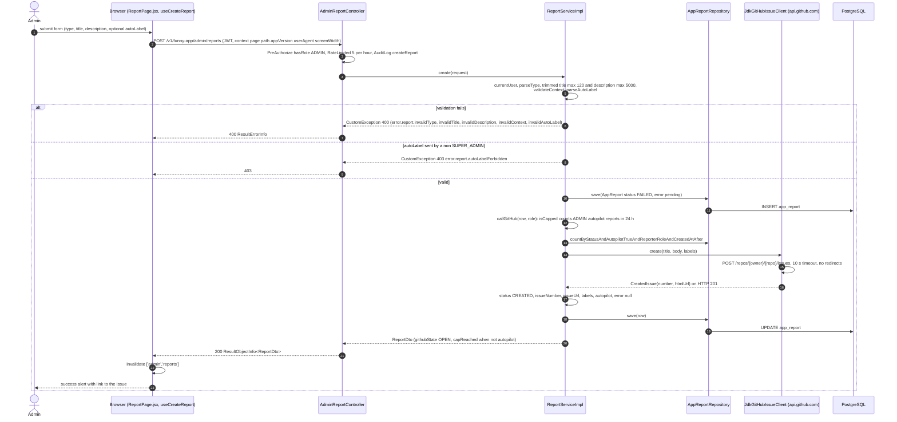
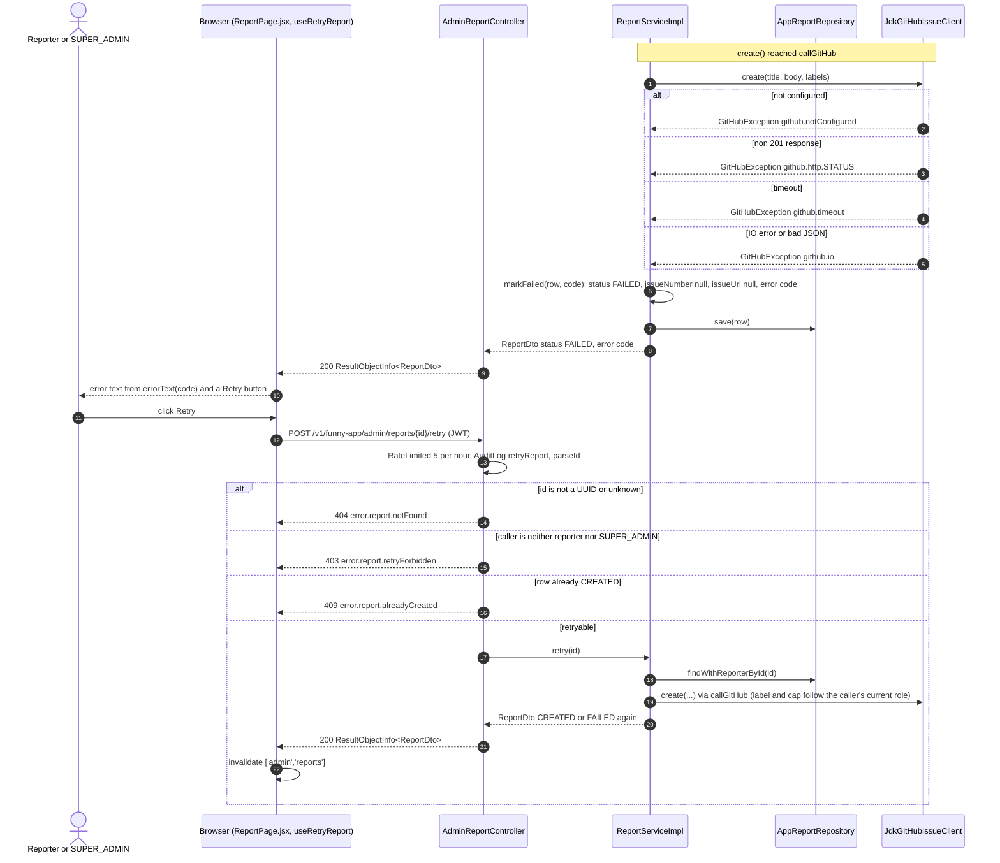
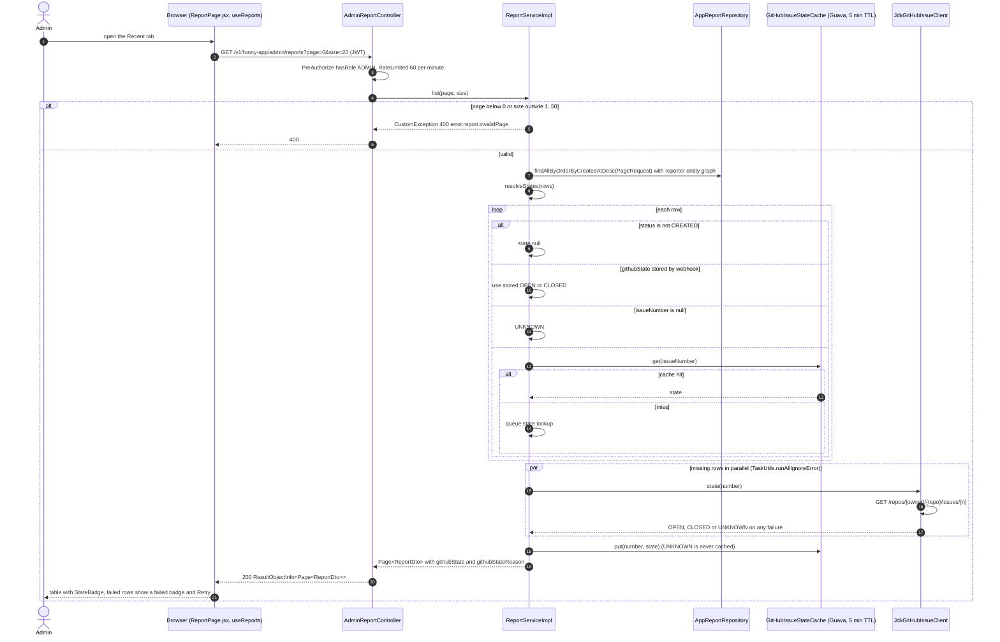
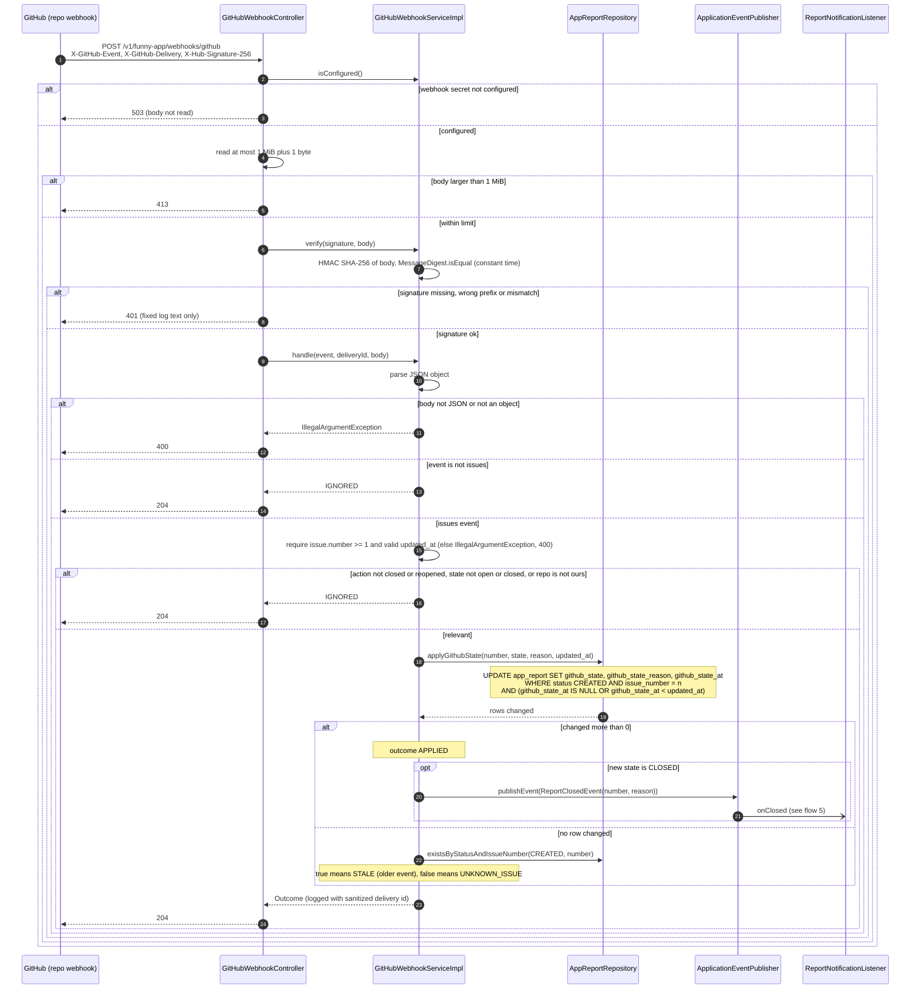
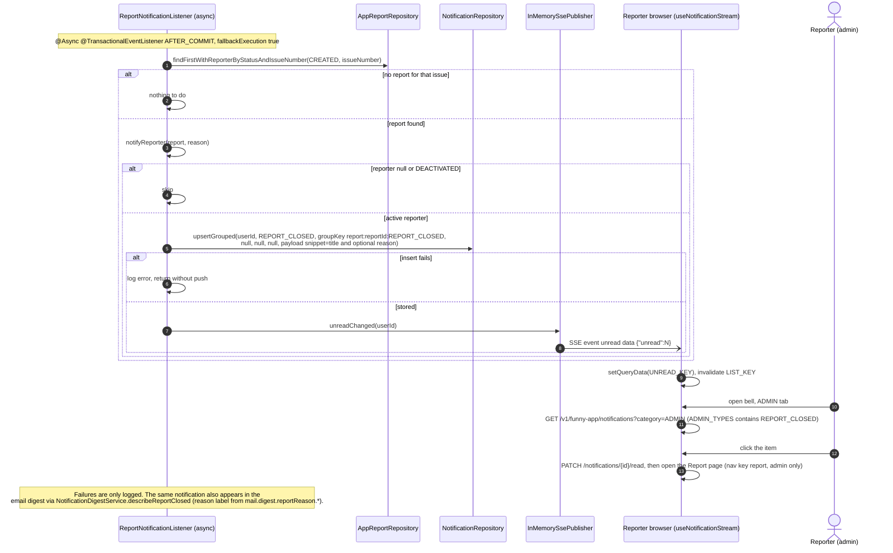

# Sequence Diagrams: In-App Report

- **PRD:** [PRD-in-app-report](../prd/PRD-in-app-report.md)
- **ADR:** [0026-in-app-report](../adr/0026-in-app-report.md)
- **Spec:** [spec-in-app-report](../specs/spec-in-app-report.md) (plans: [plan-in-app-report](../plans/plan-in-app-report.md), [plan-report-webhook-state](../plans/plan-report-webhook-state.md), [plan-report-closed-notify](../plans/plan-report-closed-notify.md))
- **Status:** As-built (2026-10-21)

Notes where the code differs from the PRD:

- PRD "Out of scope" says there is no in-app notification when an issue is closed. That is superseded: `ReportNotificationListener` now creates a `REPORT_CLOSED` notification (ADR-0026 D7).
- The 429 for rate limits comes from `@RateLimited` (5 per 3600 s on create and retry, 60 per minute on list). The AOP layer is not drawn in detail.
- The "global cap of 10 autopilot reports per 24 h" is not a rejection. Over the cap the issue is still created, without the `autopilot` label, and the DTO reports `capReached = true`.
- Retry is allowed for the reporter or a SUPER_ADMIN only (403 otherwise), although the controller is open to ADMIN.

## 1. Submit a report and create the GitHub issue

An ADMIN or SUPER_ADMIN fills the form on the Report page. The service stores the row first as FAILED with error `pending`, then calls GitHub outside any transaction, then saves the outcome. A GitHub failure does not fail the HTTP call.

## 2. GitHub failure and retry

When GitHub is down, slow or not configured, the row stays FAILED with a short error code and the response is still 200. The user can retry the same stored row.

## 3. Recent list with GitHub state resolution

The list is fetched only while the Recent tab is open. For each CREATED row the state comes from the webhook-stored column first, then a 5 minute cache, then a live GitHub call, run in parallel for the missing rows. FAILED rows get no state.

## 4. GitHub webhook receives an issue state change

GitHub posts repo webhooks to a public path with no JWT. The HMAC signature is the authentication. `/webhooks/github` POST is whitelisted in `AppConstant`. Check order in `GitHubWebhookController.receive`: 503, 413, 401, 400, 204.

## 5. ReportClosedEvent to REPORT_CLOSED notification

The webhook stores state without an outer transaction, so the listener uses `fallbackExecution = true` and runs on the async executor. It never lets an exception escape. The admin reporter then sees the item under the ADMIN tab of the bell dropdown.

