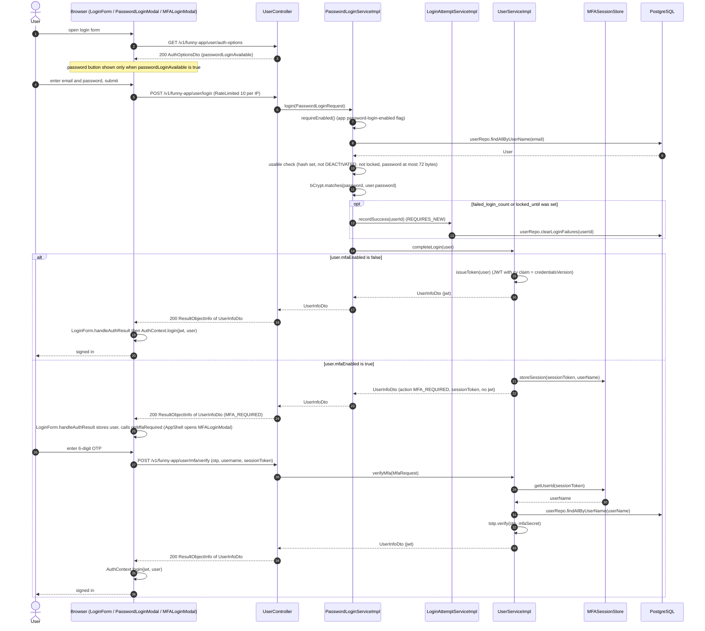
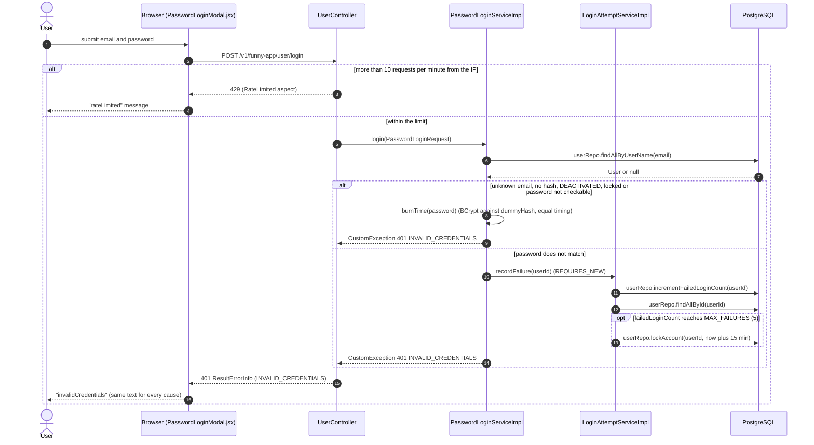
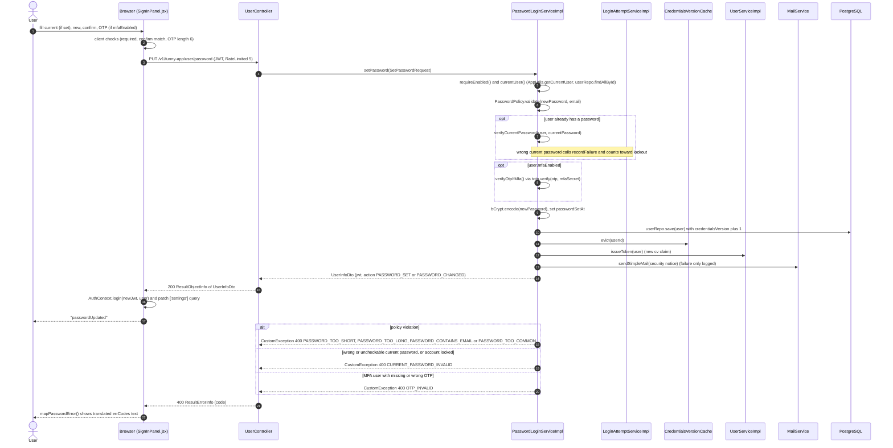
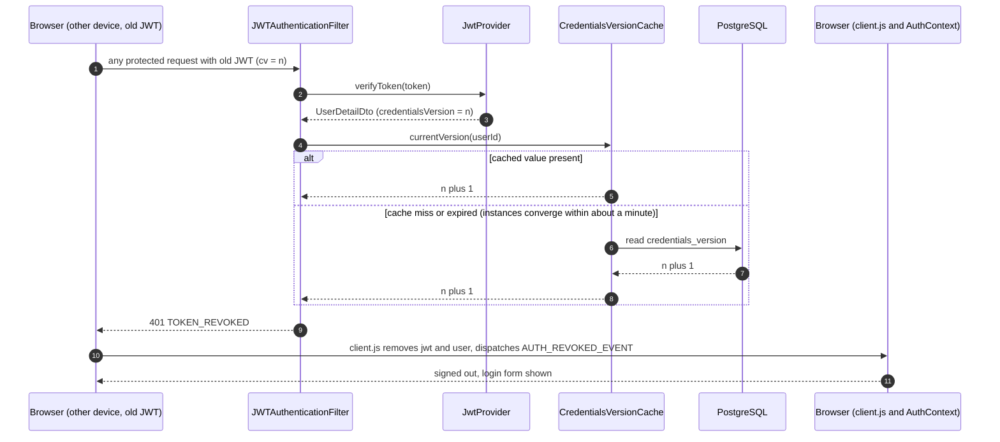

# Sequence Diagrams: Password Login

<!--
One file per feature that has a PRD: docs/sequence/sequence-<feature>.md (slug = PRD slug).
- Mermaid `sequenceDiagram` only (rendered by mkdocs via pymdownx.superfences); no PNG/PlantUML.
- Draw what the code does (or will do, per ADR/spec). Cite the class/method in each participant or note.
- One diagram per main flow: the happy path first, then the important alternative or failure paths
  (auth failure, validation error, async/event, scheduled job). 2-6 diagrams is typical.
- Participants: Browser (React page/hook) → Controller → Service → Repository/DB, plus external
  systems (YouTube, GitHub, SMTP, SSE) and async listeners/jobs. Use `autonumber`.
- Keep in sync: when the as-built flow changes, update the diagram in the same commit.
-->

- **PRD:** [PRD-password-login](../prd/PRD-password-login.md)
- **ADR:** [0018-password-login-option](../adr/0018-password-login-option.md)
- **Spec:** — (plan: [plan-password-login](../plans/plan-password-login.md))
- **Status:** As-built (2026-10-21)

Notes (code vs PRD):

- "Forgot password" in `PasswordLoginModal.jsx` makes no API call. `LoginForm.handleForgot` only closes the modal, copies the typed email into the magic-link form and shows the hint "Press Log in to receive a sign-in link by email". The user then submits the normal magic-link form (`POST /user/join`).
- All base paths below are relative to `/v1/funny-app`.

## 1. Password sign-in (happy path, with and without MFA)

A visitor opens the password dialog from the header `LoginForm`, submits email and password and gets a JWT. If the account has MFA enabled, `UserServiceImpl.completeLogin` returns `MFA_REQUIRED` plus a session token instead, and the SPA opens `MFALoginModal` to finish with `POST /user/mfa/verify`.

## 2. Password sign-in failure (generic 401, lockout, rate limit)

Every rejection (unknown email, no password set, wrong password, deactivated, locked, over-long password) returns the same `401 INVALID_CREDENTIALS`, so callers cannot enumerate accounts. A wrong password increments the failure counter in its own transaction. At 5 failures the account is locked for 15 minutes (magic link still works). The IP rate limit answers 429.

## 3. Set or change password (authenticated, MFA aware)

A signed-in user sets a first password (no current password needed) or changes an existing one (current password required) in Settings, `SignInPanel.jsx`. MFA users must also send a 6-digit OTP. Success bumps `credentials_version`, which revokes every other session, and returns a fresh JWT for the current one. Remove password (`DELETE /user/password`) follows the same path with `removePassword`, always requires the current password and sends `PASSWORD_REMOVED`.

## 4. Session revocation after a credential change

Tokens carry a `cv` claim. `JWTAuthenticationFilter` compares it with `CredentialsVersionCache.currentVersion(userId)` on every request, so a token issued before a set, change or remove is rejected with 401 `TOKEN_REVOKED`. The SPA then clears local storage and signs the user out.

