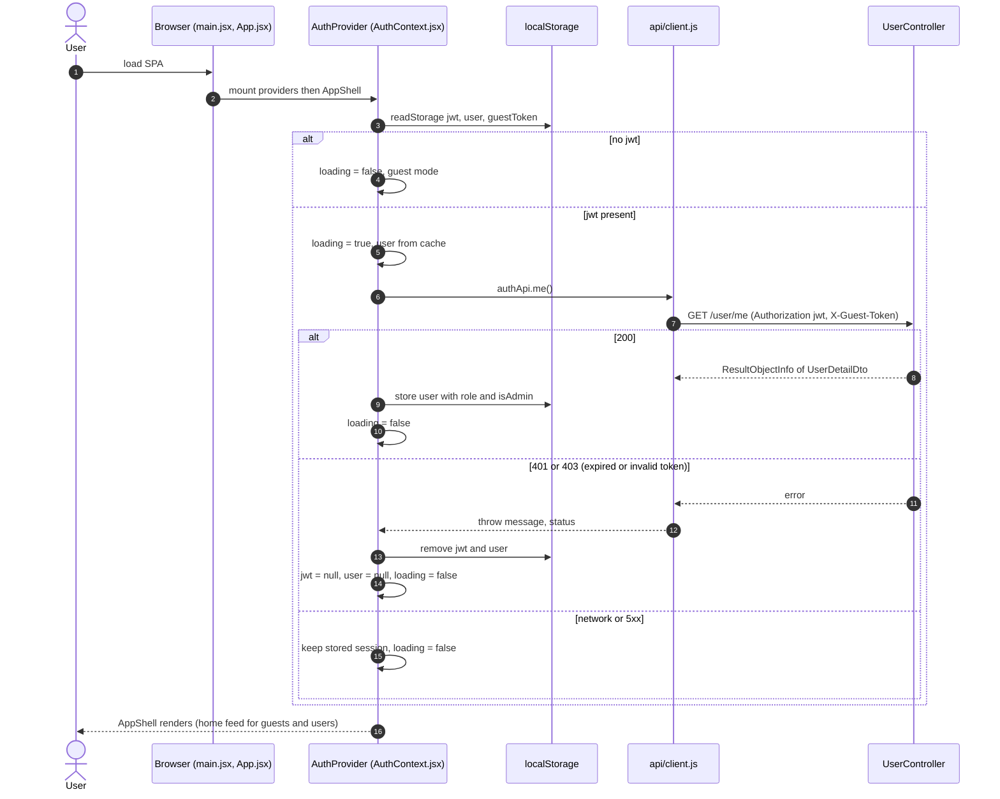
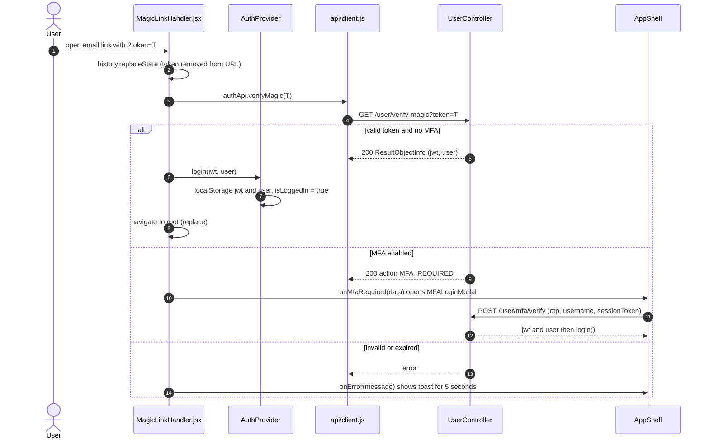
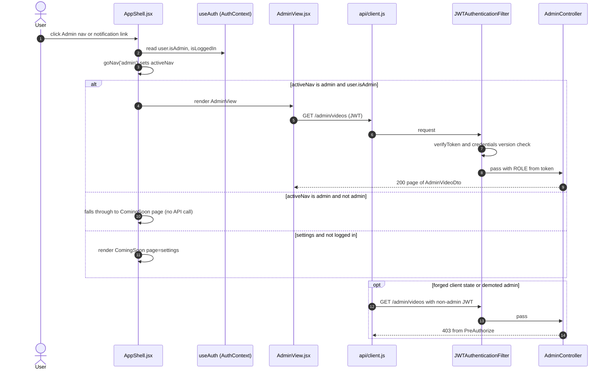
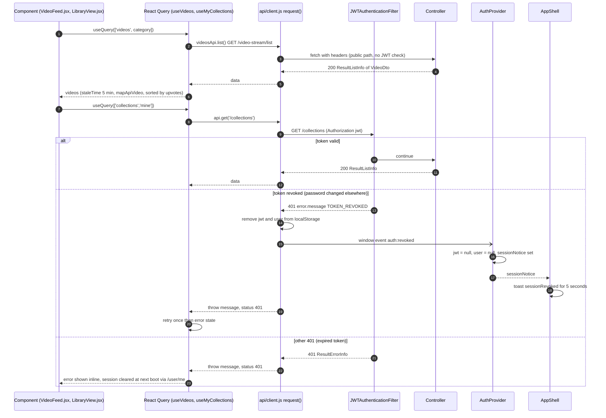

# Sequence Diagrams: React Frontend Migration (SPA runtime)

<!--
One file per feature that has a PRD: docs/sequence/sequence-<feature>.md (slug = PRD slug).
- Mermaid `sequenceDiagram` only (rendered by mkdocs via pymdownx.superfences); no PNG/PlantUML.
- Draw what the code does (or will do, per ADR/spec). Cite the class/method in each participant or note.
- One diagram per main flow: the happy path first, then the important alternative or failure paths
  (auth failure, validation error, async/event, scheduled job). 2-6 diagrams is typical.
- Participants: Browser (React page/hook) → Controller → Service → Repository/DB, plus external
  systems (YouTube, GitHub, SMTP, SSE) and async listeners/jobs. Use `autonumber`.
- Keep in sync: when the as-built flow changes, update the diagram in the same commit.
-->

- **PRD:** [PRD-react-migration](../prd/PRD-react-migration.md)
- **ADR:** [0008-react-migration](../adr/0008-react-migration.md)
- **Spec:** —
- **Status:** As-built (2026-10-21)

> **PRD vs code.**
> - The PRD status is `Planning` but the SPA is live in `webapp/` (ADR-0008: Accepted, implemented).
> - PRD says React Router v6 for routing. The code uses `react-router-dom` v7 but defines no `<Route>` elements. `BrowserRouter` only provides `useNavigate` to `MagicLinkHandler`, and screens are switched by an `activeNav` state in `AppShell`.
> - PRD says react-bootstrap and Font Awesome. The UI uses custom CSS tokens and Material Symbols.
> - PRD lists `/private-videos`, the private tab and `/share-links` POST. The private tab was removed and share links are being retired. Only `DELETE /share-links/{id}` remains in `videosApi`.
> - `webapp/CLAUDE.md` mentions Axios, but `src/api/client.js` uses `fetch`. The `Authorization` header carries the raw JWT with no `Bearer ` prefix.
> - There is no global React Query 401 handler. 401 handling lives in `client.js` (TOKEN_REVOKED only) and `AuthContext` (the `/user/me` check at boot).

All API calls go to `VITE_API_BASE_URL`, default `https://canh-labs.com/api/v1/funny-app`.

## 1. App boot and JWT restore

On load, `main.jsx` renders `App`, which nests `BrowserRouter`, `QueryClientProvider` (retry 1, no refetch on focus), `ThemeProvider`, `AuthProvider`, `AppShell`. `AuthProvider` reads `jwt`, `user` and `guestToken` from localStorage and, when a JWT exists, validates it with `GET /user/me`.

## 2. Magic link sign-in (?token= in the URL)

`MagicLinkHandler` (mounted in `AppShell`) runs once, strips the token from the address bar and exchanges it for a JWT. Accounts with MFA get an intermediate `MFA_REQUIRED` answer.

## 3. Screen guard (no router routes)

There are no protected routes. `AppShell` picks the screen from `activeNav` and renders admin screens only when `user.isAdmin` is true. The server is the real gate: `AdminController` is `@PreAuthorize("hasRole('ADMIN')")` and `JWTAuthenticationFilter` rejects bad tokens with 401.

## 4. React Query data fetch with 401 handling

A hook such as `useVideos` or `useMyCollections` calls `api.get`. `client.js` adds `Authorization`, `X-Guest-Token` and `Accept-Language`. Only a `TOKEN_REVOKED` 401 triggers a global logout through the `auth:revoked` window event. Any other failure is thrown as `{ message, status, code }` to React Query, which retries once (`retry: 1`) and then exposes `error` to the component.

