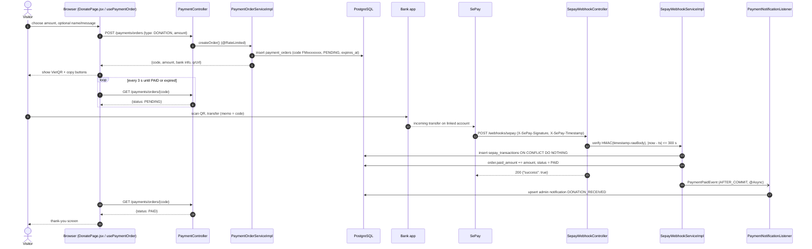
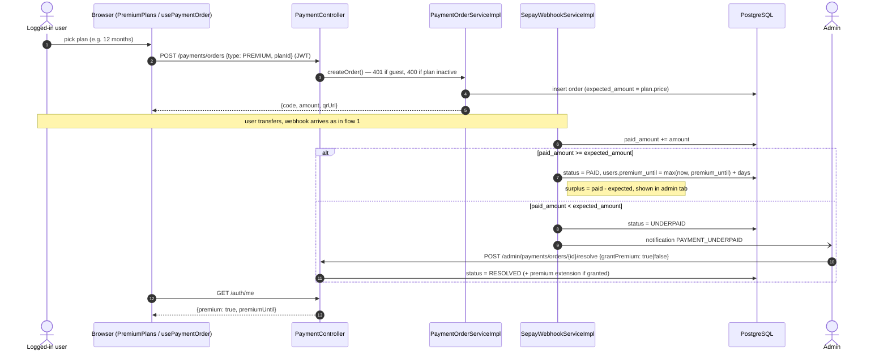
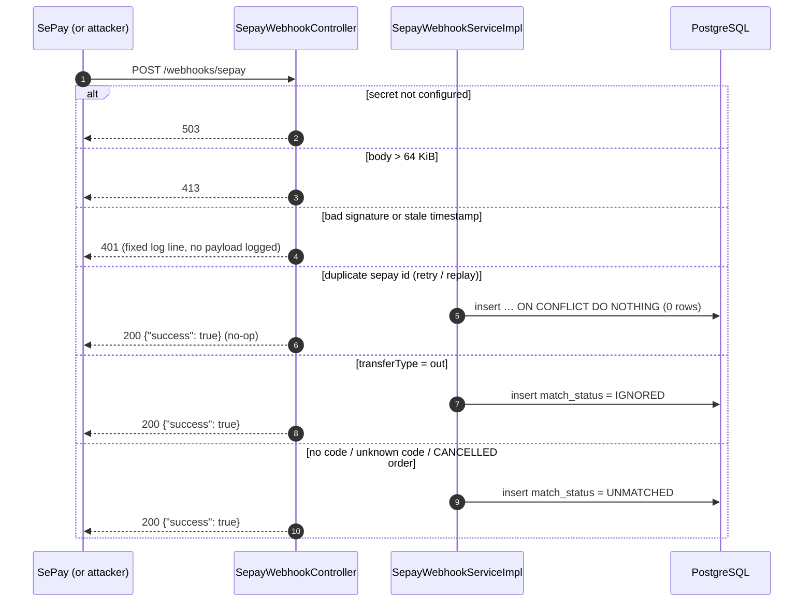
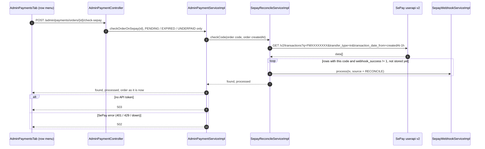
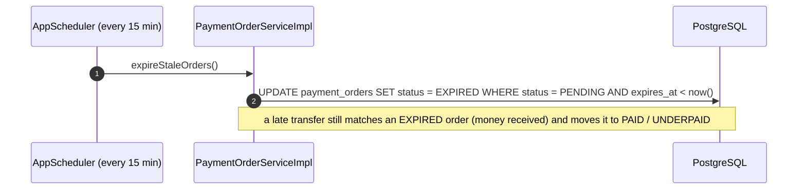

# Sequence Diagrams: SePay Payments (Donations and Premium)

- **PRD:** [PRD-sepay-payments](../prd/PRD-sepay-payments.md)
- **ADR:** [0037-sepay-bank-transfer-payments](../adr/0037-sepay-bank-transfer-payments.md)
- **Spec:** —
- **Status:** Draft (2026-11-12) — class names are the planned ones from [plan-sepay-payments](../plans/plan-sepay-payments.md)

## 1. Donation happy path (guest or user)

A visitor picks an amount, scans the VietQR, and the page flips to "thank you" once SePay reports the transfer.



## 2. Premium purchase, including underpaid



## 3. Webhook rejection and edge cases



## 4. Reconciliation job (missed webhooks)

```mermaid
sequenceDiagram
    autonumber
    participant J as AppScheduler reconcile-sepay (daily 00:15, day T-1)
    participant R as SepayReconcileServiceImpl
    participant API as SePay userapi v2
    participant WS as SepayWebhookServiceImpl
    participant DB as PostgreSQL

    J->>R: reconcile()
    alt Harness flag sepay_reconcile_enabled off, or no API token
        R-->>J: return, no call
    end
    loop pages until has_more = false (max 10, 400 ms apart)
        R->>API: GET /v2/transactions?q=FM&transfer_type=in&transaction_date_from=yesterday 00:00 (Bearer token)
        API-->>R: data[], meta.pagination
    end
    Note over R: keep yesterday's rows (T-1) with an FM code; webhook_success = 1 counted as webhook, the rest go through UUID to negative sepay_id
    R->>DB: which sepay_ids are already stored
    loop each new row
        R->>WS: process(tx, source = RECONCILE), same path as webhook
        WS->>DB: skip if same reference + amount already stored, else insert ON CONFLICT DO NOTHING and match
    end
    alt 401 / 429 / 5xx / bad body
        R-->>J: stop, log result=api_error; rerun the day from the admin Jobs tab
    end
```

## 4b. Admin checks one order on SePay



## 5. Order expiry job


