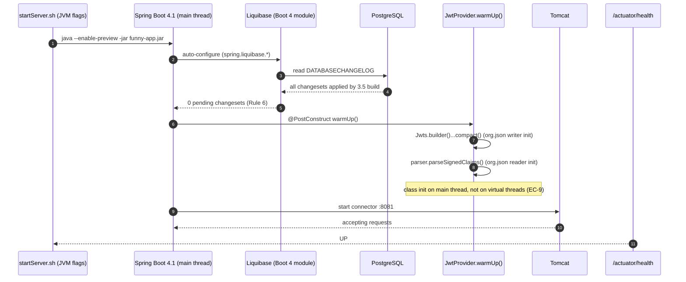
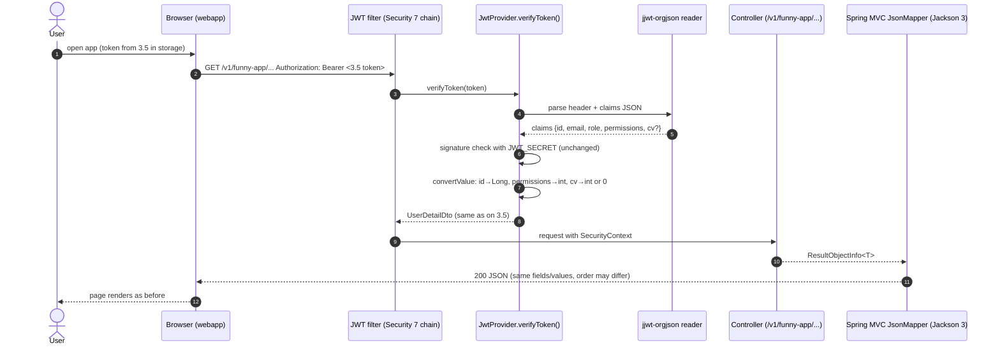
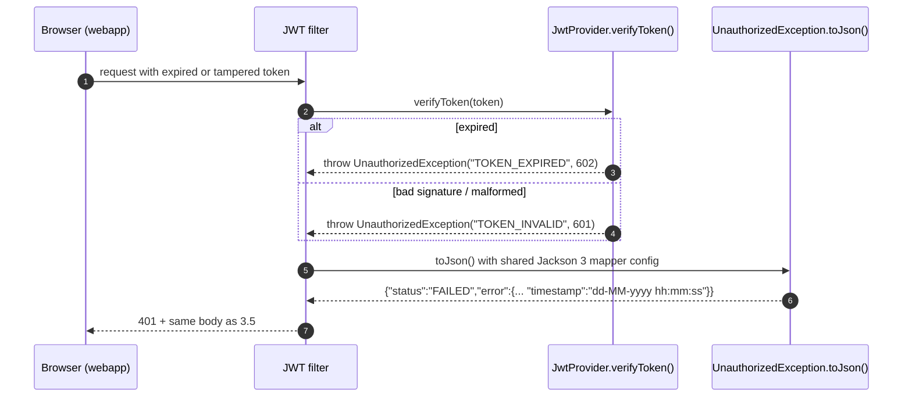
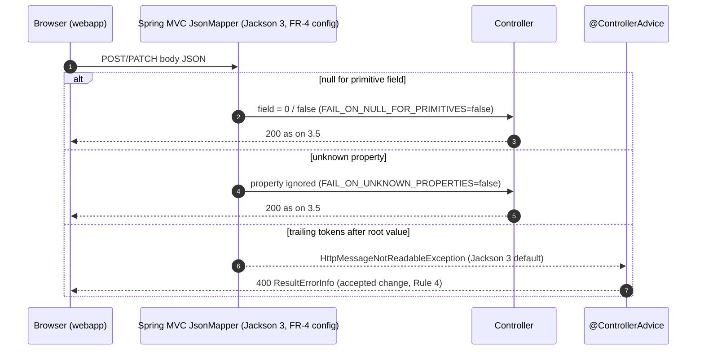
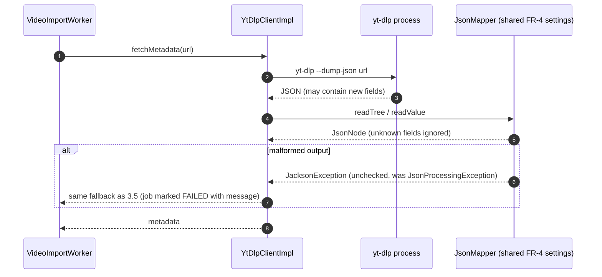
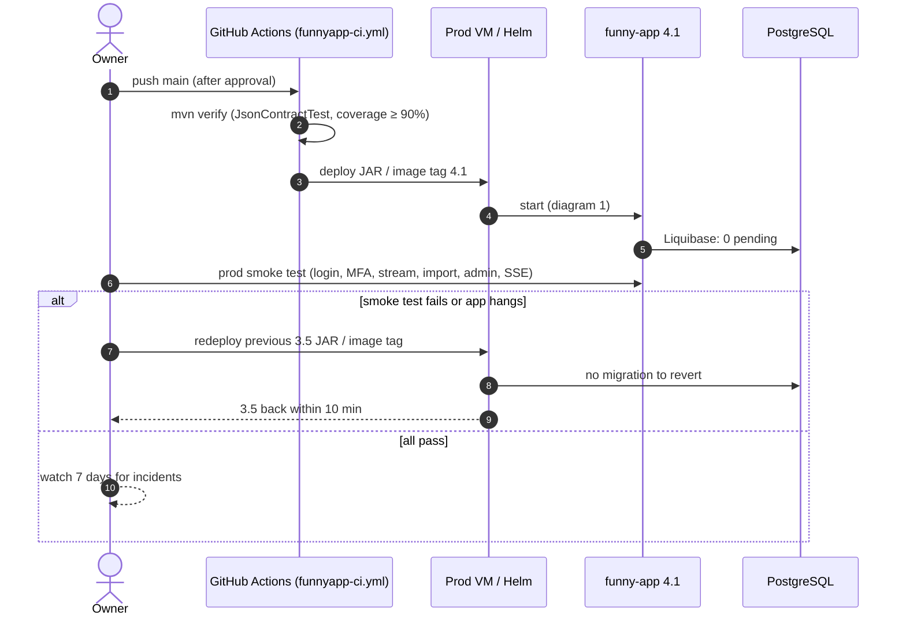

# Sequence Diagrams: Spring Boot 4.1 Upgrade

- **PRD:** [PRD-spring-boot-4-upgrade](../prd/PRD-spring-boot-4-upgrade.md)
- **ADR:** [0033-spring-boot-4-upgrade](../adr/0033-spring-boot-4-upgrade.md)
- **Spec:** [spec-spring-boot-4-upgrade](../specs/spec-spring-boot-4-upgrade.md)
- **Status:** Draft

The upgrade adds no new flow. These diagrams show the existing flows whose internals change: which component now does the work (Jackson 3, `jjwt-orgjson`, Boot 4 modules), and where the spec's rules and edge cases apply.

## 1. Startup on the prod VM (Boot 4.1)

The JVM starts with the existing `startServer.sh` flags. Liquibase must find nothing to apply, and the JWT/JSON classes are warmed up before Tomcat accepts traffic (spec FR-2, FR-5, Rule 6, EC-9).

## 2. Authenticated request with a token issued before the upgrade

A user who logged in on 3.5 calls an API after the deploy. The JSON claims are now parsed by org.json instead of Jackson 2 (spec Rule 5, EC-1, EC-2).

## 3. Expired or tampered token

The failure path keeps the same sub-codes and body format (spec EC-3, FR-4).

## 4. Request body deserialization rules

How the Jackson 3 mapper configured in FR-4 handles a client request body (spec Rules 3–4, EC-4, EC-5, EC-6).

## 5. Parsing an external payload with a code-built mapper

The classes that built their own `ObjectMapper` now use the shared Jackson 3 settings, so a provider adding fields does not break parsing (spec FR-4, EC-5). This example uses yt-dlp; YouTube API, GitHub webhook and ChatGPT follow the same pattern.

## 6. Deploy and rollback

The upgrade ships as one artifact. Rollback means redeploying the previous 3.5 artifact; no database step is needed (spec NFR Availability, Rule 6).

