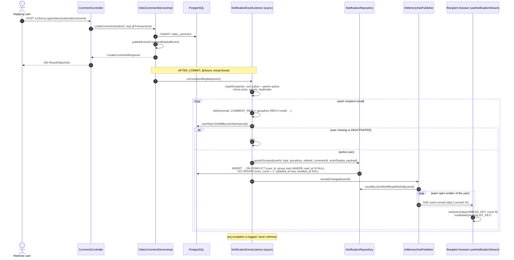
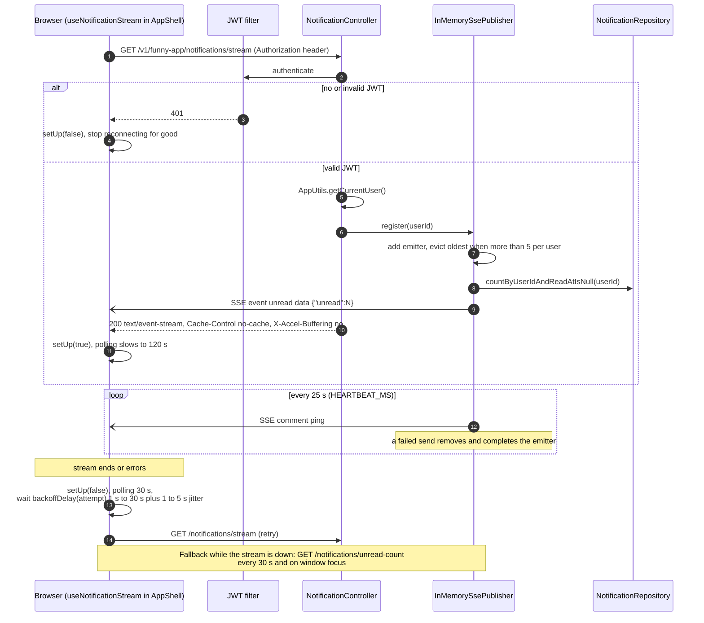
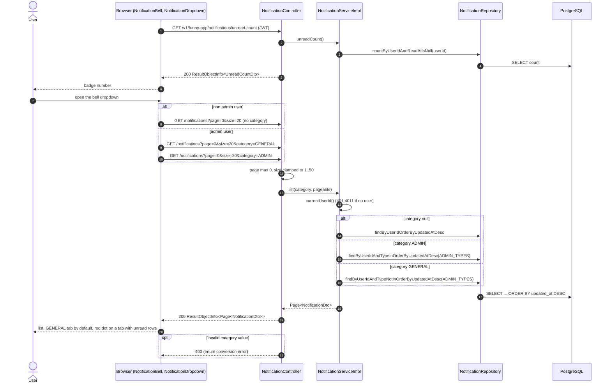
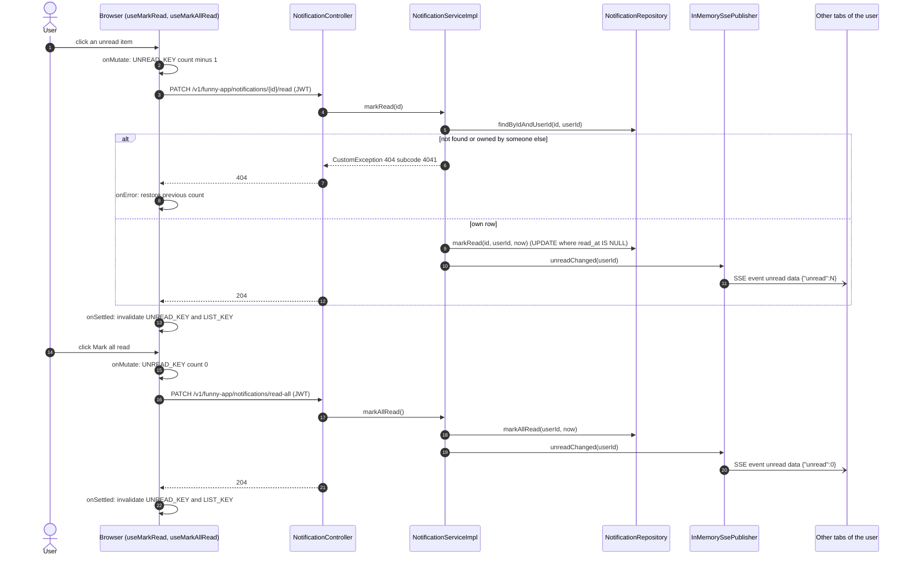
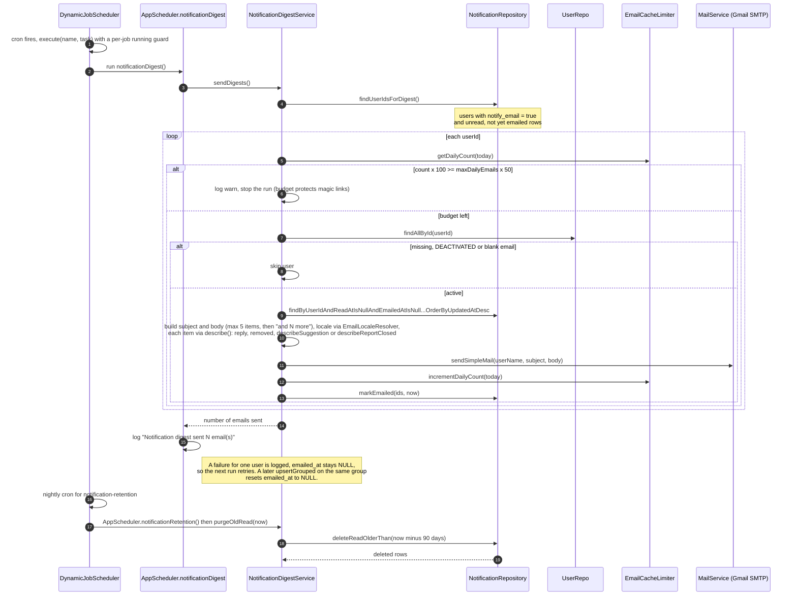

# Sequence Diagrams: User Notifications

- **PRD:** [PRD-user-notifications](../prd/PRD-user-notifications.md)
- **ADR:** [0017-user-notifications](../adr/0017-user-notifications.md)
- **Spec:** — (plan: [plan-user-notifications](../plans/plan-user-notifications.md))
- **Status:** As-built (2026-10-21)

Notes where the code differs from the PRD:

- The SSE event is named `unread` with data `{"unread":N}` (the server-side publisher method is `NotificationPublisher.unreadChanged(userId)`).
- The PRD predates `REPORT_CLOSED` and the `category` filter. `NotificationType.ADMIN_TYPES` is `{REPORT_CLOSED}`. `GET /notifications?category=GENERAL|ADMIN` is accepted from any logged-in user, because the controller and service do no admin check. Only the React dropdown limits the two tabs to admins (`user.isAdmin`).
- `NotificationType` has six values, not only comment replies: `COMMENT_REPLY` and `COMMENT_REMOVED` (`NotificationEventListener`), `SUGGESTION_APPROVED`, `SUGGESTION_REJECTED` and `SUGGESTION_LIVE` (`SuggestionNotificationListener`), and `REPORT_CLOSED` (`ReportNotificationListener`, driven by `ReportClosedEvent`). They all use the same upsert, SSE push, list and digest path shown below. Diagram 1 draws only the comment-reply producer.
- The email digest formats each type per item: `describeSuggestion` for the three `SUGGESTION_*` types, `describeReportClosed` for `REPORT_CLOSED` (reason label from `mail.digest.reportReason.*`), a "removed" line (with optional reason) for `COMMENT_REMOVED`, and the reply line (actor, "and N others", snippet) for `COMMENT_REPLY`.
- Emitters are held in memory per JVM (`InMemorySsePublisher`), at most 5 per user, 30 minute timeout.

## 1. Event to notification row to SSE unread push

A comment reply is committed, an async listener upserts one grouped notification row per recipient, then pushes the new unread count to the recipient's open tabs. `CommentRemovedEvent` follows the same path through `onCommentRemoved`. `ReportClosedEvent` uses `ReportNotificationListener` (see the in-app-report diagrams).

## 2. SSE stream connect, heartbeat and reconnect

The logged-in browser opens one `fetch` based stream (JWT in the `Authorization` header, never in the URL). The hook is mounted once in `AppShell`.

## 3. Bell dropdown list with optional category filter

The bell shows the badge from `GET /notifications/unread-count`. Opening the dropdown loads page 0 (size 20, shows the first 10). Admins get two tabs, GENERAL and ADMIN, each its own query.

## 4. Mark one read and mark all read

Both calls are optimistic in the browser. The service commits the update first (the service methods are deliberately not transactional), then asks the publisher to push the fresh count to every open tab.

## 5. Email digest and retention scheduled jobs

`DynamicJobScheduler` reads the `scheduled_job` table at startup (`ApplicationReadyEvent`) and runs `JobRegistry` tasks by cron. Seeded crons from the Liquibase changelog `202610190002-create-scheduled-job.sql`: `notification-digest` is `0 */15 * * * *`, `notification-retention` is `0 30 3 * * *` in zone Asia/Ho_Chi_Minh. The PRD says "every 15 min", which matches.

