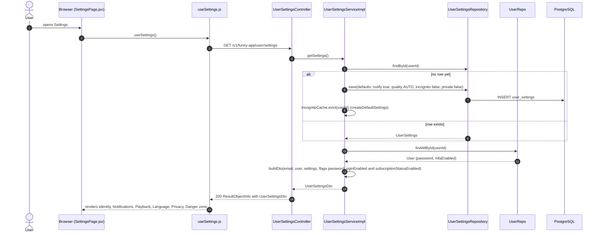
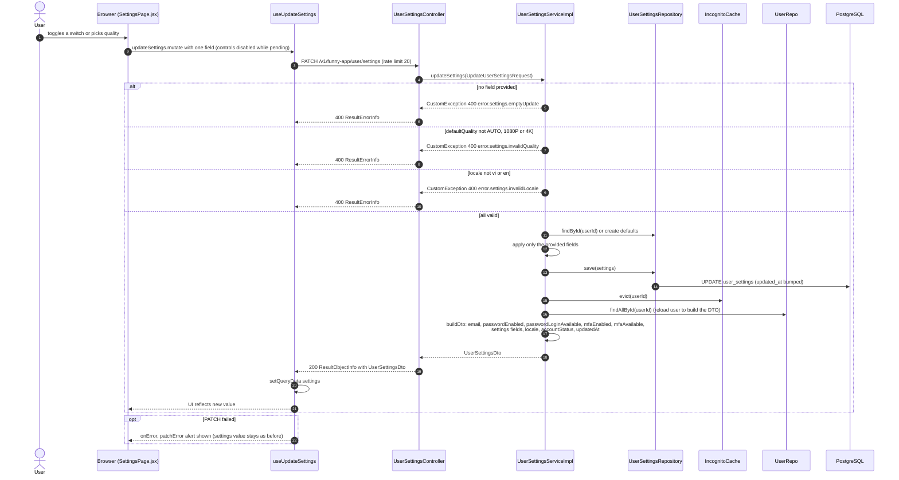
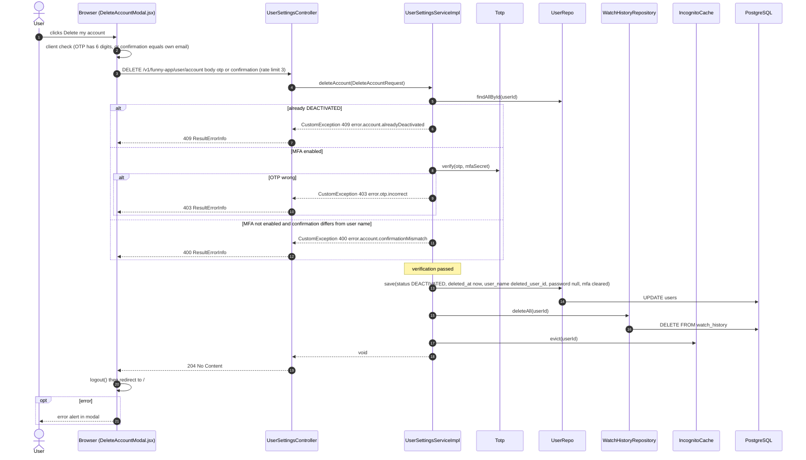
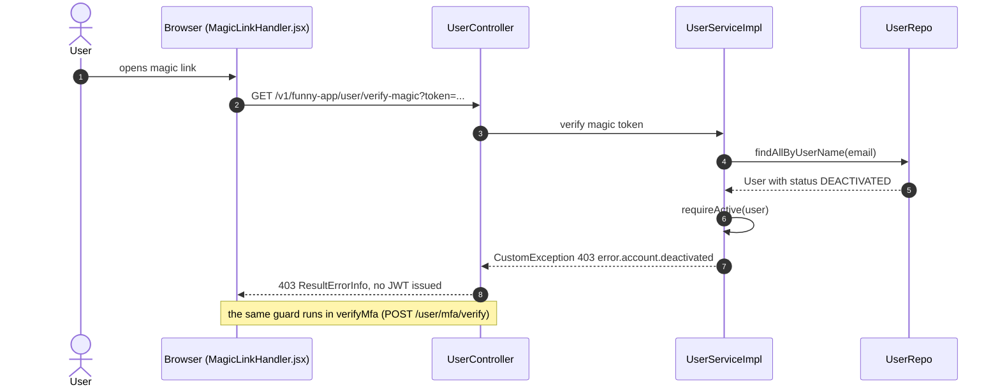

# Sequence Diagrams: User Settings

- **PRD:** [PRD-user-settings](../prd/PRD-user-settings.md)
- **ADR:** [0016-user-settings-design](../adr/0016-user-settings-design.md)
- **Spec:** [spec-user-settings](../specs/spec-user-settings.md)
- **Status:** As-built (2026-10-21)

All endpoints are under `/v1/funny-app` and need a JWT. `UserSettingsController` is class-level `@AuditLog`, so `otp` and `confirmation` are masked in audit logs.

## 1. Open Settings page (GET settings, lazy create)

The user opens `/settings`. `SettingsPage.jsx` loads settings through `useSettings()`. The first call creates a defaults row.

## 2. Change a setting (partial, atomic PATCH)

Each toggle or quality button sends only its own field. The service validates every provided field before writing anything, so one bad field rejects the whole request.

## 3. Delete account (step-up verification)

The Danger zone opens `DeleteAccountModal.jsx`. An MFA user types a 6 digit OTP, other users type their email. The server soft-deletes and anonymizes, then the client logs out.

## 4. Deactivated account cannot sign in

After deletion the account is rejected on the magic-link and MFA paths. `UserServiceImpl.requireActive` throws 403. The password login path also refuses deactivated users.

## Notes: PRD/spec vs code

- The spec lists `POST /user/join` as guarded. As built, `/user/join` only sends a magic link via `inviteService.inviteUser` and does not check status. The guard is in `UserServiceImpl` (`verify-magic` and `verifyMfa`) and in `PasswordLoginServiceImpl` (`/user/login`).
- The spec says editable fields are five. As built, `locale` (vi or en) is a sixth editable field (ADR-0020), and `UpdateUserSettingsRequest.isLocaleProvided()` lets the client send an explicit null.
- The spec says toggles may revert on error. As built there is no optimistic update: the UI waits for the 200 and shows `patchError` on failure.
- `defaultQuality` is stored and returned, but no player code in `webapp/src` reads it yet (only `SettingsPage.jsx`). Incognito is consumed by watch history (see sequence-watch-history-v2).
- `profilePrivate` is stored only, no other feature reads it in the code searched.
- The spec says the session or token is invalidated server-side on delete. As built, `deleteAccount` does not touch tokens and does not bump `credentialsVersion`. `JWTAuthenticationFilter` (lines 71-73) only compares the token's `cv` claim with `CredentialsVersionCache.currentVersion` and does no user status check, so an old JWT keeps working until it expires. The client calls `logout()` and redirects, which only discards the token locally.
