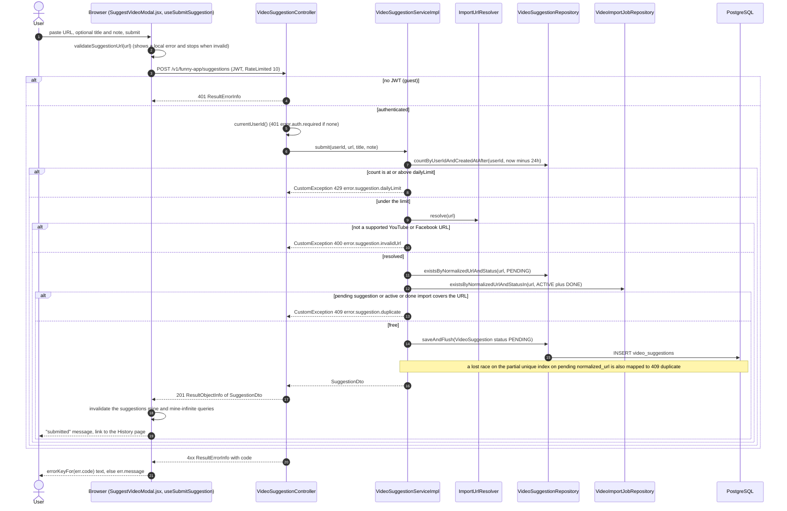
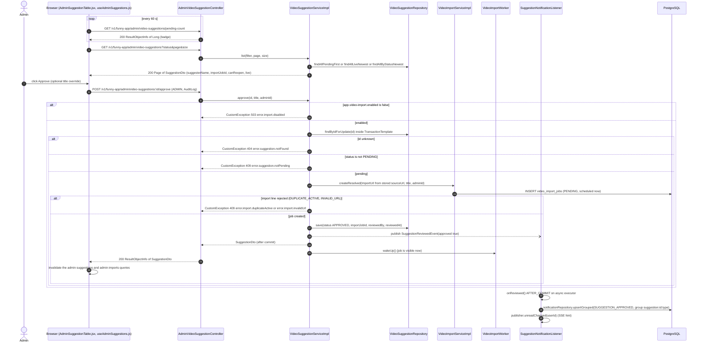
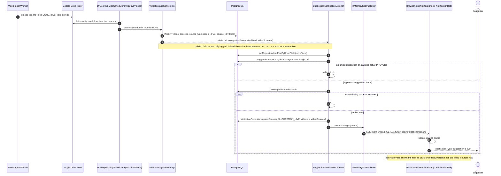
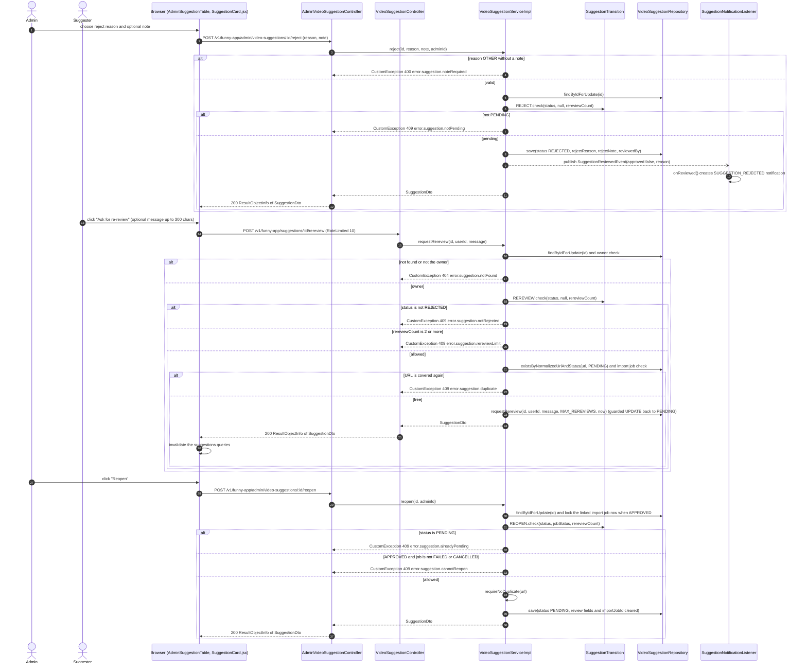

# Sequence Diagrams: Video Suggestions

<!--
One file per feature that has a PRD: docs/sequence/sequence-<feature>.md (slug = PRD slug).
- Mermaid `sequenceDiagram` only (rendered by mkdocs via pymdownx.superfences); no PNG/PlantUML.
- Draw what the code does (or will do, per ADR/spec). Cite the class/method in each participant or note.
- One diagram per main flow: the happy path first, then the important alternative or failure paths
  (auth failure, validation error, async/event, scheduled job). 2-6 diagrams is typical.
- Participants: Browser (React page/hook) → Controller → Service → Repository/DB, plus external
  systems (YouTube, GitHub, SMTP, SSE) and async listeners/jobs. Use `autonumber`.
- Keep in sync: when the as-built flow changes, update the diagram in the same commit.
-->

- **PRD:** [PRD-video-suggestions](../prd/PRD-video-suggestions.md)
- **ADR:** — (no ADR of its own. The PRD builds on [0019-admin-video-import](../adr/0019-admin-video-import.md) and [0017-user-notifications](../adr/0017-user-notifications.md))
- **Spec:** — (plan: [plan-video-suggestions](../plans/plan-video-suggestions.md). Later changes: [plan-suggestion-transitions](../plans/plan-suggestion-transitions.md), [plan-suggestion-rereview](../plans/plan-suggestion-rereview.md))
- **Status:** As-built (2026-10-21)

Notes (code vs PRD):

- Base path for every endpoint is `/v1/funny-app`. In the diagrams `:id` stands for the path variable `{id}`. Suggestion endpoints are not in any public path list, so the JWT filter answers 401 for guests.
- The PRD describes submit, duplicate (409) and daily limit (429, default 5 per 24 hours, `app.video-suggestion.daily-limit`). The code matches. The code also has features the PRD does not draw: `POST /suggestions/{id}/rereview` (max 2 per suggestion), `POST /admin/video-suggestions/{id}/reopen`, and a `LIVE` filter.
- The quota is checked before the URL is resolved, so an over-quota user never triggers a network call to resolve a share link.
- Approve reuses the import pipeline: it creates one `video_import_jobs` row through `VideoImportService.createResolved`. A video becomes live only after the Drive sync ingests the uploaded file (see the admin video import diagrams).

## 1. User submits a suggestion

A logged-in user taps "+" in `AppShell.jsx`, which opens `SuggestVideoModal.jsx` (admins go straight to the Import tab instead). The modal validates the URL locally, then posts to `VideoSuggestionController.submit`. The new row starts as `PENDING`.

## 2. Admin reviews: approve creates an import job

The Admin tab (`AdminSuggestionTable.jsx`, `useAdminSuggestions.js`) lists suggestions with pending first and polls `pending-count` every 60 s for the badge. Approve runs in one transaction under a row lock on the suggestion, creates exactly one import job scheduled now, and publishes `SuggestionReviewedEvent`. After commit the worker is woken again and the suggester is notified.

## 3. Import finishes and the suggester is told the video is live

The import job downloads the video and uploads it to the Drive folder. The Drive sync (cron job `sync-drive-videos` or the admin force sync) later saves the `video_sources` row and publishes `VideoIngestedEvent`. The listener links the Drive file id back to the job, then to the approved suggestion, and notifies the suggester.

## 4. Reject, re-review request and reopen

An admin rejects a pending suggestion with a reason (note is required for `OTHER`). The suggester can ask for a re-review at most `MAX_REREVIEWS` (2) times, which moves the suggestion back to pending. An admin can also reopen a rejected suggestion, or an approved one whose import ended `FAILED` or `CANCELLED`. All transitions are decided by `SuggestionTransition` and run under a row lock.

