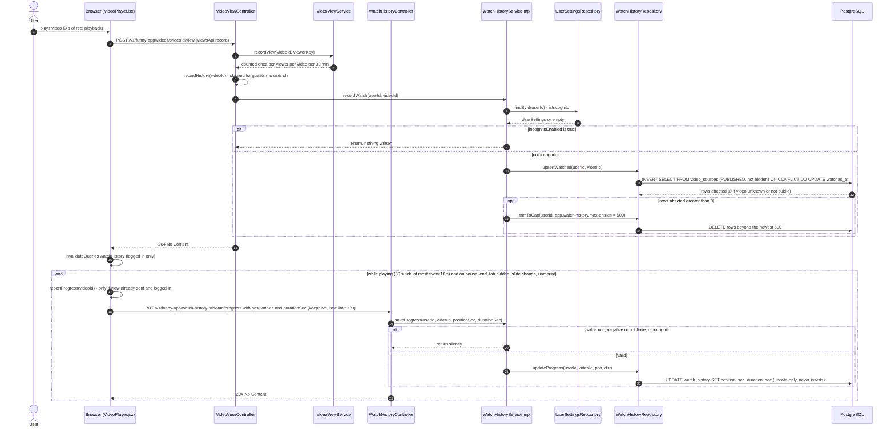
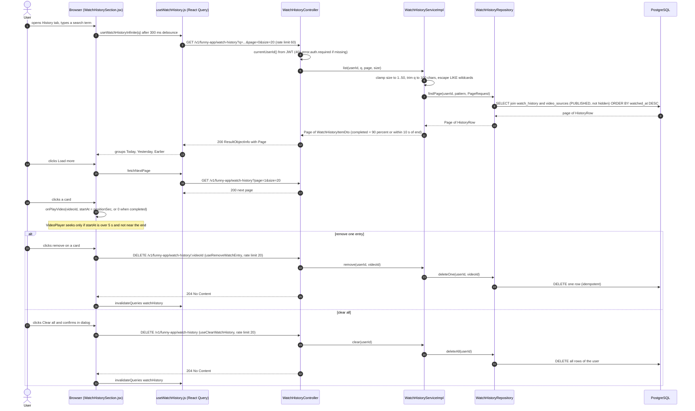
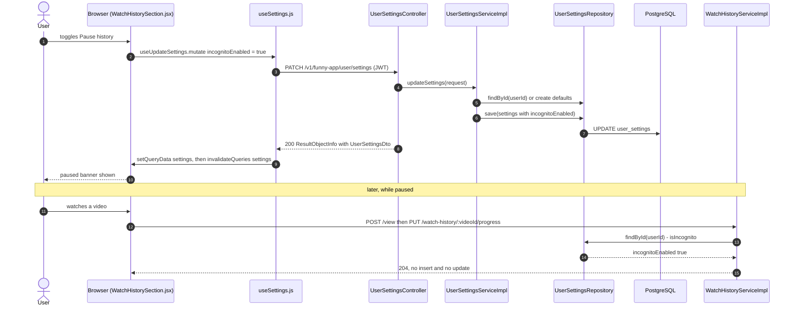
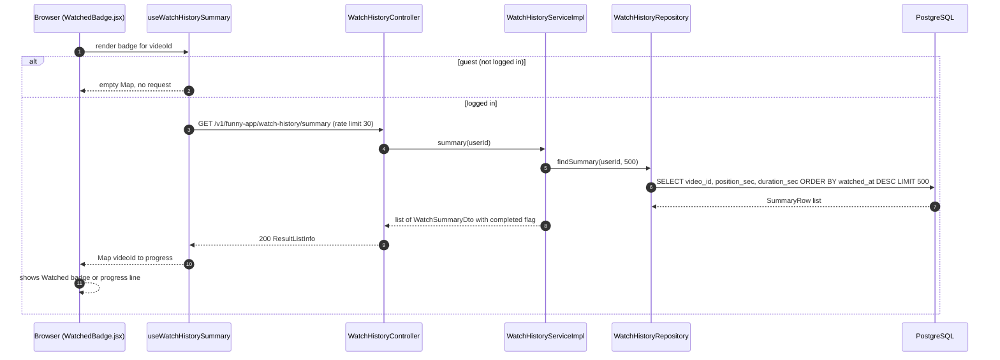
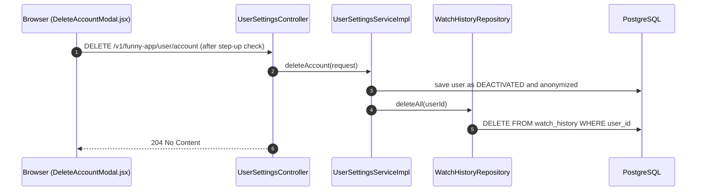

# Sequence Diagrams: Watch History v2

- **PRD:** [PRD-watch-history-v2](../prd/PRD-watch-history-v2.md)
- **ADR:** [0021-watch-history](../adr/0021-watch-history.md)
- **Spec:** — (plan: [plan-watch-history-v2](../plans/plan-watch-history-v2.md))
- **Status:** As-built (2026-10-21)

All endpoints are under `/v1/funny-app`. The user id always comes from the JWT (`AppUtils.getCurrentUser()`), never from the request. Writes are native SQL in `WatchHistoryRepository` (ADR-0021). In the diagrams `:videoId` stands for the path variable `{videoId}`.

## 1. Record a watch (view reported) and save resume position

A logged-in user plays a video. After 3 s of real, visible playback `VideoPlayer.jsx` calls the public view endpoint, which also upserts the history row. Later the player sends the resume point (update-only) on a 30 s tick (at most every 10 s), on pause, on end, on tab hidden, and on slide switch or unmount. The history write is best effort: a failure is logged and the view still returns 204.

## 2. Browse, search, resume and manage history (History tab)

The user opens History, then the "Lich su xem" tab (`WatchHistorySection.jsx`). The list is newest first, grouped by day on the client, with a debounced title search (300 ms) and "load more" paging (page size 20). Clicking a card plays the video at the saved position unless it is completed.

## 3. Pause history (incognito switch) and its effect

The "Tam dung lich su" switch on the History tab is the same flag as Settings, Incognito: `user_settings.incognito_enabled` (PRD OQ-4, one flag). While it is on, `recordWatch` and `saveProgress` return without writing. Existing entries stay visible and can still be removed.

## 4. Watched badges (summary) in feed and Explore

`WatchedBadge.jsx` uses `useWatchHistorySummary()`: one shared request (query key `watchHistory`, `summary`, stale time 60 s), only for logged-in users. Guests get an empty map and no request.

## 5. Account deletion clears history

Soft-deleting the account (see sequence-user-settings) also removes all watch history rows.

## Notes: PRD vs code

- `PUT /watch-history/:videoId/progress` is update-only and is only sent after the view has counted (`viewSentRef`), so a row always exists first.
- `POST /videos/:videoId/view` is public. The history write is skipped for guests inside `VideoViewController.recordHistory` and never fails the view.
- The history cap is configurable (`app.watch-history.max-entries`, env `WATCH_HISTORY_MAX_ENTRIES`, default 500), while the summary limit is a fixed 500 (`WatchHistoryServiceImpl.SUMMARY_LIMIT`).
- List and search hide videos that are hidden or not PUBLISHED, but the summary query does not join `video_sources`, so those rows can still appear in the badge map.
