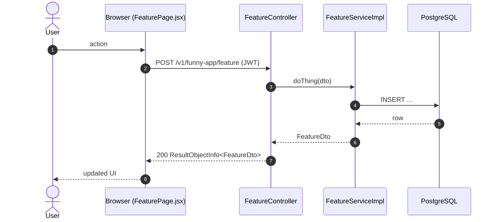
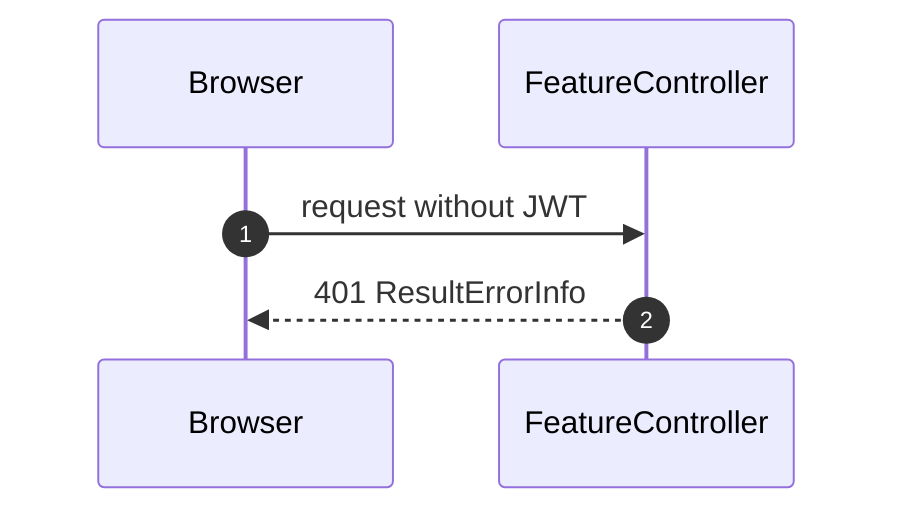

# Sequence Diagrams: [Feature Name]

<!--
One file per feature that has a PRD: docs/sequence/sequence-<feature>.md (slug = PRD slug).
- Mermaid `sequenceDiagram` only (rendered by mkdocs via pymdownx.superfences); no PNG/PlantUML.
- Draw what the code does (or will do, per ADR/spec). Cite the class/method in each participant or note.
- One diagram per main flow: the happy path first, then the important alternative or failure paths
  (auth failure, validation error, async/event, scheduled job). 2-6 diagrams is typical.
- Participants: Browser (React page/hook) → Controller → Service → Repository/DB, plus external
  systems (YouTube, GitHub, SMTP, SSE) and async listeners/jobs. Use `autonumber`.
- Keep in sync: when the as-built flow changes, update the diagram in the same commit.
-->

- **PRD:** [PRD-<feature>](../prd/PRD-<feature>.md)
- **ADR:** [NNNN-<topic>](../adr/NNNN-<topic>.md) (or —)
- **Spec:** [spec-<feature>](../specs/spec-<feature>.md) (or —)
- **Status:** Draft | As-built (YYYY-MM-DD)

## 1. [Main flow name]

[One or two sentences: trigger, actor, outcome.]

## 2. [Alternative / failure flow]

